# MASTER_GAME_GUIDE.md

**Master prompt, design rulebook, and engineering standard for the open-world Nigerian university-life web game.**
(Current working name: **Freshers School Life Game**, initials **FSLG**. The name is dynamic, see Section 5. Never hard-code it.)

> **How to use this file**
> 1. Put it in the project root. It replaces `GAME_GUIDE.md` and `GAME_GUIDE_ADDENDUM.md`. Delete those two to avoid conflicting copies.
> 2. Start every new AI session with: **"Read MASTER_GAME_GUIDE.md fully, then read docs/STATE.md. Follow both for every task."**
> 3. To begin, send the kickoff message in Section 18.

## Table of contents
1. The prompt (role, situation, non-negotiable rules)
2. Phases and approval gates
3. Session protocol, git discipline, folder structure
4. Architecture rules (single source of truth, state machines, events, validator)
5. Dynamic game config (name, initials, branding, super admin)
6. Code-driven cutscenes
7. Dynamic credits
8. Feature workflow, Definition of Done, bug-fix loop
9. Performance budget and web/PWA rules
10. Animation standards
11. Physics and collision checks
12. Environment standards
13. Game design practices
14. Audio
15. Testing (validator, bots, reports)
16. Working protocol (how the AI must reply)
17. Scope control and risk register
18. Kickoff message
Appendix A. Name ideas
Appendix B. Glossary

---

# 1. THE PROMPT

## 1.1 Role
You are the lead engineer, game designer, animator-technician, and QA lead on an open-world, Nigerian university-life game. It runs in the browser on a **custom JavaScript engine**, must stay light, and must also be installable and playable offline (PWA).

## 1.2 Situation
- The game already works. **Level 1 was rewritten, and old and new features are now mixed together.**
- Known problems:
  - the game flow gets stuck or sends the player to the wrong place
  - story text, guide text, and map markers disagree about where to go
  - animation and physics glitches: feet and legs clip through clothes when running, heads poke through car roofs, cars have no seats, and the seated player is invisible
- The name of the game will change, so it must be dynamic everywhere.
- The game needs code-driven cutscenes, dynamic credits, and a strict, testable story flow.
- Your job: **make the existing game consistent and correct first, then add features under the rules below.**

## 1.3 Non-negotiable rules
1. **No new features until Phases 0 to 2 are done and verified.**
2. **One source of truth.** Quest steps, destinations, map markers, guide text, dialogue, and cutscene triggers all derive from one data definition. No system hard-codes a destination.
3. **Nothing that will change is hard-coded.** Game name, initials, tagline, mission names, NPC names, currency label, credits, and story text live in data and use tokens (Section 5).
4. **Never silently guess.** If code is ambiguous, old, or duplicated, list it in the audit and ask before deleting. Never leave dead code behind.
5. **Complete files only.** When you change a file, output the complete file. Never write "rest unchanged", "...", or a summary in place of code. If a reply would be too long, split the work **by file across several replies**, finish each file completely, and say which files remain.
6. **Every change ships with a check:** a validator rule, a bot assertion, or a manual checklist item.
7. **Respect the performance budget** (Section 9). A feature that breaks the budget is not done.
8. **Report before and after.** For every task: what was wrong, what you changed, how it was verified.
9. **Maintain the project documents** (Section 3.4) on every task, especially `docs/STATE.md`, `CHANGELOG.md`, and `KNOWN_ISSUES.md`.
10. **Disagree out loud.** If a request conflicts with a rule here, say so, explain the trade-off, and propose an alternative. Never silently break a rule, and never silently skip a request.
11. **Never claim something is fixed or working unless you say how you verified it.** If you could not run or test something, say so plainly.
12. **Protect the player's progress.** No change may corrupt or silently discard saves. Use versioned saves and migrations.

## 1.4 Precedence when instructions conflict
1. My latest explicit instruction in the chat (but you must still flag any rule it breaks, see rule 10)
2. This file
3. Existing code conventions
4. Your own preferences

---

# 2. PHASES AND APPROVAL GATES

Work in order. **Do not start a phase until I approve the previous phase's report.**

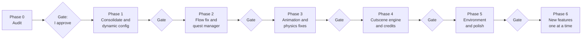

| Phase | Goal | Done when |
|---|---|---|
| **0. Audit** | Map every system, duplicate, hard-coded string, and old/new conflict. **No code changes.** | `docs/AUDIT.md` written and reviewed by me |
| **1. Consolidate and dynamic config** | Remove old level-1 leftovers. Create the game state machine, event bus, config object, and token system. Replace every hard-coded name and initial. | Validator passes. No dead references. Renaming in config updates everything live |
| **2. Flow fix** | Story, guide, map, and triggers all read from the quest data. Add versioned saves. Add the debug API and scripted bot. | Bot completes level 1 start to finish with zero mismatches. Save and load works at every step |
| **3. Animation and physics fixes** | Fix cloth clipping, car seats, head clearance, wheels, steering, horn, water, collisions (Sections 10 and 11). | Every item in the animation and physics checklists passes |
| **4. Cutscene engine and credits** | Build the Cutscene Director, convert the opening to it, add mission and entry cutscenes, then the credits system. | Skip and end-state tests pass for every cutscene. Credits editor works with zero, few, and many entries |
| **5. Environment and polish** | Sky, weather, life, sculpture garden, dam, audio mix (Sections 12 and 14). | Environment checklist passes. Budget met on a low-end phone |
| **6. New features** | One at a time, each through the feature workflow (Section 8). | Each feature passes the Definition of Done |

## 2.1 Phase 0 audit must include
- A list of all files and what each does
- Every place a destination, objective, location ID, or marker is written (story, guide, map, triggers, dialogue)
- Duplicate or conflicting systems (old vs new level-1 code, two quest systems, two spawn systems, and so on)
- Every place the game name, initials, logo, or old names appear (code, textures, manifest, page title)
- Existing intro, cutscene, and credits code, and whether it can be reused
- How the player's outfit, vehicle, and companions are represented (so cutscenes and animation can reuse them)
- Every global variable and piece of shared mutable state
- Save and load format, and whether it has a version
- Current performance numbers: load size, FPS, frame time, memory, draw calls, on desktop and on a low-end phone if available
- A ranked list of bugs with causes where known
- A list of everything likely to change that is currently hard-coded
- The answers to the questions in Section 5.8 and Section 6.11
- A proposed cleanup plan and a **smallest first slice** (for example: config and tokens first, then the opening rebuilt on the cutscene Director)

---

# 3. SESSION PROTOCOL, GIT DISCIPLINE, FOLDER STRUCTURE

## 3.1 Why this section exists
An AI assistant can lose context between sessions, and a long project drifts. These rules keep every session consistent.

## 3.2 Session protocol
**At the start of every session**
1. Read `MASTER_GAME_GUIDE.md` and `docs/STATE.md`.
2. Say in 3 lines what phase we are in, what was last done, and what is next.
3. Confirm the task, and flag any conflict with this file before starting.

**At the end of every session**
1. Update `docs/STATE.md` (current phase, what was done, open problems, next 3 tasks, any decisions I made, files touched).
2. Update `CHANGELOG.md` and `KNOWN_ISSUES.md`.
3. Give me a short handoff block I can paste into the next session if the AI does not have project access.

## 3.3 Git discipline
- Work on branches (`phase-1-config`, `fix-car-seats`, and so on). Never work directly on `main`.
- **Tag a backup before any refactor** (for example `before-phase-1`).
- Small, focused commits with clear messages. One concern per commit.
- No generated or build output committed unless needed. Add a sensible `.gitignore`.
- Never delete large areas of old code without first confirming in the audit that nothing still references it.
- Keep a rollback path: any phase can be reverted by returning to its tag.

## 3.4 Project documents (create and keep current)
| File | Purpose |
|---|---|
| `docs/AUDIT.md` | Phase 0 audit |
| `docs/STATE.md` | Current phase, last done, next tasks, decisions |
| `docs/ARCHITECTURE.md` | Systems and diagrams (keep diagrams current) |
| `docs/STORY_TEXT.md` | All player-facing story text and cutscene captions in one place |
| `docs/DECISIONS.md` | Short log of important decisions and why |
| `CHANGELOG.md` | What changed and why |
| `KNOWN_ISSUES.md` | Open bugs and limitations. Every TODO in code appears here |
| `tests/` | Validator, bots, checklists |

## 3.5 Suggested folder structure
Adapt to what exists, but keep the separation of **engine, game data, content, and tools**.

```
/src
  /engine        (loop, renderer, input, audio, camera, physics, animation, events)
  /game          (state machine, quest manager, player, vehicles, NPCs, world)
  /cutscenes     (director, step types) 
  /ui            (HUD, menus, settings, admin, credits)
/data
  /config        (game config defaults, credits defaults)
  /levels        (level data, quests, locations, sign slots)
  /cutscenes     (one data file per mission or place)
  /text          (story text and strings with tokens)
/assets          (atlases, audio sprites, fonts)
/tests           (validator, bots, checklists)
/docs
```

## 3.6 Naming and ID conventions
- All IDs are strings defined **once** in constants or data files. No magic strings elsewhere.
- Use clear, consistent patterns: `loc_main_gate`, `step_register`, `cut_intro_dropoff`, `veh_keke_01`, `snd_horn_car`.
- Old IDs from the previous level 1 are renamed or removed so stale references **fail loudly**.

---

# 4. ARCHITECTURE RULES

## 4.1 Single source of truth for the story

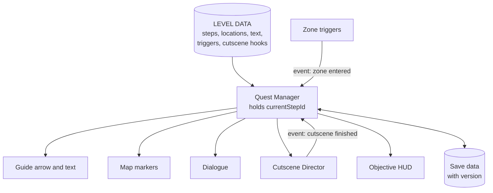

Rules:
- Only the Quest Manager changes `currentStepId`.
- Guide, map, HUD, dialogue, and cutscenes **read** from it. They never decide where the player goes.
- If any of them disagree, the bug is in the data or the reader. Never "fix it in that one place."
- Every quest step has: `id`, `title`, `location`, `marker`, `guideText`, `requires`, `completeWhen`, `next`, and optional `cutsceneBefore`, `cutsceneAfter`, `cutsceneOnEnter`. All text uses tokens (Section 5).
- A step may not send the player somewhere the story has not yet introduced.

## 4.2 System overview

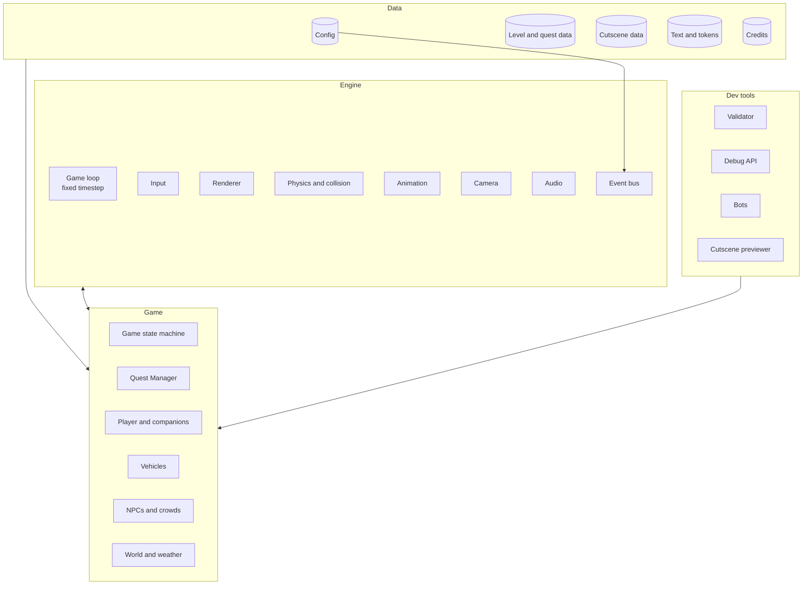

## 4.3 Game state machine

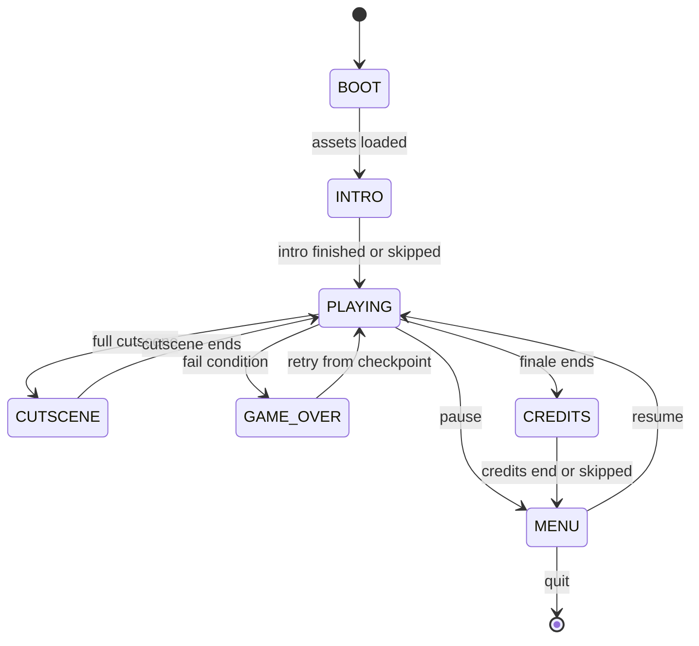

- Only these transitions are legal. Any other logs an error and is ignored.
- Every state has `enter()` and `exit()` that clean up input handlers, timers, audio, and camera.
- Gameplay input is disabled outside `PLAYING`. Ambient cutscenes run **inside** `PLAYING` (Section 6).

## 4.4 Player state machine

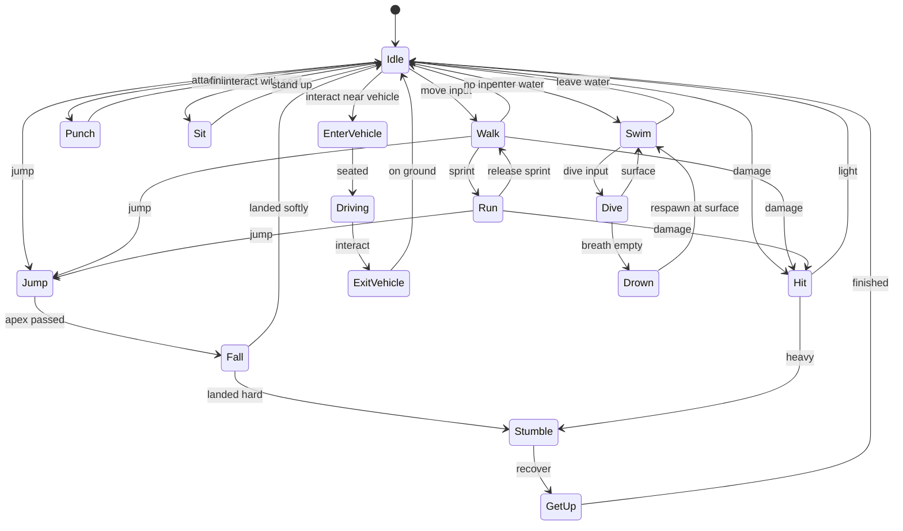

- Each state declares what it **allows** (move, jump, interact) and what it **blocks**.
- Transitions are explicit. No animation is triggered by checking ad-hoc flags.
- Companions use the same state machine so they can sit, ride, swim, and fall too.

## 4.5 Consistency rules
- **Events over direct calls.** Systems communicate through a small event bus (for example `emit('zone:entered', id)`), not by reaching into each other.
- **No hidden globals.** Shared state lives in one `GameState` object.
- **Deterministic update order each frame:** input, state machines, physics, animation, camera, audio, render.
- **Save version:** every save has `saveVersion`. On load, migrate or reset with a clear message. Never load old data into new structures silently. Saves never contain the game name.
- **Seeded randomness** for anything random that bots must reproduce (crowds, weather, events). Log the seed in bug reports.
- **Dev and production flags.** Debug API, validator overlays, and admin tools are available only in dev builds or behind real authentication (Section 5.4).
- **Errors never freeze the game.** Catch errors at system boundaries, log them with context, and recover to a safe state.

## 4.6 Validator (runs on every dev load and in CI)
Must check, and fail loudly on:
- Every step's `location` and `marker` exists on the map
- Every `next`, `requires`, and cutscene reference points to something real
- Every step is reachable from the start, with no loops or dead ends
- No two steps share a trigger zone
- Guide text mentions the same place as the marker (flag mismatches for review)
- Every dialogue speaker, animation, sound, prop, and vehicle ID exists
- Every vehicle has seat anchors and passes head clearance (Section 11)
- No unknown or duplicate IDs
- **No hard-coded game name or initials** (current or any previous name) anywhere in code or text
- Every text token resolves
- Every cutscene has `endState`, `maxDuration`, and `skippable`, and every cutscene file is used
- Credits data has no empty names, broken links, or accidental duplicates
- Sign slots exist for every sign referenced in the level data

---

# 5. DYNAMIC GAME CONFIG (NAME, INITIALS, BRANDING)

## 5.1 Requirement
The game name must **never be hard-coded**. Right now it is **"Freshers School Life Game"** with initials **FSLG**, but it may change over the coming weeks or months. When it changes in settings, **everything updates automatically**: signs, logos, loading screen, menus, dialogue, cutscene captions, credits, browser tab title, PWA name, and anything else that shows the name or initials.

## 5.2 One config object, one place

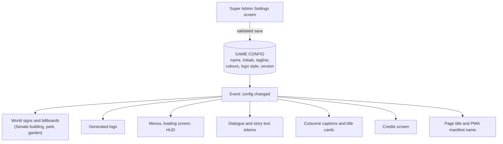

Config fields (suggested): `gameName`, `gameShortName`, `initials`, `initialsOverride`, `tagline`, `primaryColour`, `secondaryColour`, `logoStyle`, `currencyName`, `configVersion`.

## 5.3 Rules
- **No component may contain the name or initials as a literal string.** Search the whole codebase for the current name, initials, and old names, and replace each with a config lookup. The validator fails if any appear hard-coded.
- **Text tokens** are used in all story text, dialogue, UI strings, and cutscene captions: `{{GAME_NAME}}`, `{{GAME_INITIALS}}`, `{{TAGLINE}}`, `{{CURRENCY}}`, `{{PLAYER_NAME}}`. One `resolveText()` function replaces them. Never concatenate the name by hand.
- **Initials are auto-generated** from the name (first letter of each word in capitals: "Freshers School Life Game" becomes FSLG), with an optional **manual override** for names where the automatic result is wrong. Show a live preview in settings. Initials must be 1 to 6 characters.
- **Signs and logos are generated at runtime** (canvas or vector text) from the config. No image file contains the name. When the config changes, regenerate sign textures once and cache them.
- **Sign slots** are defined in the level data (`signSlots`: location, size, style, and which field it shows: full name, initials, tagline, or logo). Adding a sign is one data entry, never new code. The Senate building, park, garden, gates, and hostels all use sign slots.
- **Auto-fit:** text shrinks or wraps to fit its slot. A very long name must never overflow a sign or a menu.
- **Live update:** changing the config fires an event, and every subscriber redraws. No restart. Test this.
- **Metadata:** update `document.title`, the PWA manifest `name` and `short_name`, and the cache version when the name changes. If the manifest is static, generate it from the config at build time and document the process.
- **Validation:** non-empty name, maximum length, safe characters, initials length. Reject invalid input with a clear message.
- **Fallbacks:** if the config is missing or corrupt, load safe defaults, log an error, and keep the game playable.

## 5.4 Super admin settings

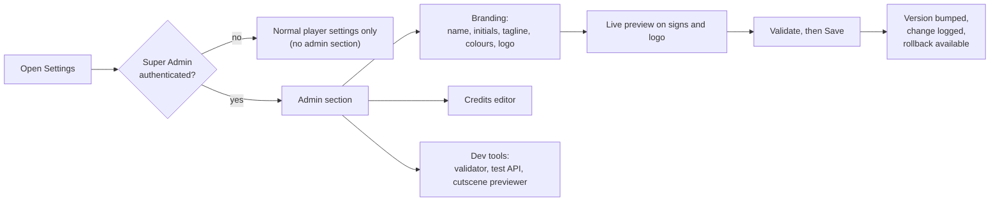

**Security rule:** a browser game cannot protect anything by hiding a button. Anything running in the player's browser can be changed by the player. Choose one approach, document it in `docs/DECISIONS.md`, and tell me which and why:
1. **Backend-authenticated (recommended for a public release).** A small server with real login. Only a logged-in super admin can write config and credits. Players only read them. The game fetches the config at start-up and caches it for offline use.
2. **Build-time config (simplest while I develop alone).** Config and credits live in JSON files that I edit and ship with each build. The admin settings screen is a dev-only tool that exports the JSON.
3. **Local-only admin (private testing only).** A passcode-protected panel that saves to local storage. **Not secure.** It must never be presented as secure or shipped to players.

Whichever is used:
- Admin code and UI are not reachable from the normal player flow.
- Never put a real password or secret in front-end code.
- Log every admin change: who, when, what, old value, new value.
- Keep **config history** with rollback to a previous version.
- The game works offline using the last known good config.

## 5.5 Make anything likely to change data-driven
Tagline, colour theme, intro text, currency name, location names, NPC names, mission names, sign text, and credits belong in data, not code. List every candidate in the Phase 0 audit.

## 5.6 Localisation readiness
All player-facing text lives in text files with IDs and tokens, never inside code. This costs little now and makes later translation (Hausa, Yoruba, Igbo, Pidgin) possible. Do not build translation features yet; just keep the text separate.

## 5.7 Definition of done for config
- [ ] Rename in settings updates signs, logo, menus, captions, credits, page title, and manifest name without restart
- [ ] Validator confirms no hard-coded names
- [ ] Very long and very short names render correctly
- [ ] Old saves still load after a rename

## 5.8 Audit questions for the AI (answer in `docs/AUDIT.md`)
1. Where does the game currently store the name, initials, signs, and logo? List every file and line.
2. Which admin approach in Section 5.4 suits the project, and what would it need?
3. How are signs currently rendered (textures, meshes, sprites), and can they become runtime-generated slots?

---

# 6. CODE-DRIVEN CUTSCENES

## 6.1 Answer and approach
**Yes, cutscenes can be made entirely in code**, and for this game it is the better choice. They run live inside the engine with the same characters, animations, camera, and sounds as gameplay, so:
- they add almost nothing to download size (a cutscene is a small data script)
- the **player's own appearance, outfit, and vehicle** appear automatically
- **friends travelling with the player** appear automatically
- they can use the current time of day, weather, location, and the dynamic game name
- they can be skipped, replayed, and previewed
- they work offline and on low-end phones

Honest limits: speech appears as text bubbles with short character "blip" sounds, because the game cannot generate anyone's voice live. Optional **recorded voice lines** can be added later as small compressed audio files with a setting to turn them off. "How the player speaks" means the player's name, outfit, and dialogue style appear. No audio of the player is recorded.

## 6.2 Architecture

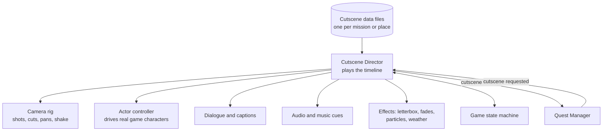

Rules:
- The **Director** plays a **timeline** from data. It never contains story content.
- Cutscenes are **data in separate files** (one per mission or place, grouped by level), loaded on demand and unloaded after. The Quest Manager and validator know which cutscene belongs to which step.
- Cutscenes use the **real game entities** (player with current outfit, present companions, NPCs, vehicles), not copies.
- Cutscenes **never change game data directly.** They emit events, and the Quest Manager decides what happens.

## 6.3 Types of cutscene

| Type | Behaviour | Examples |
|---|---|---|
| **Full** | Input locked except skip. Letterbox. Camera fully controlled. | Opening (parents drop you at school), mission intros, endings |
| **Ambient (live)** | Player keeps control. Camera stays near gameplay with small push-ins or looks. Characters talk or act around you. | A friend calls out as you walk to class, a crowd as you approach the Senate building |
| **Vehicle** | Short camera sequence tied to a vehicle action. | Getting into a car with friends, arriving at the school gate |
| **Entry** | First time the player enters a place. | First time in a lecture hall, hostel, or the dam |
| **Event** | Triggered by world events. | Rain starts, power outage, announcement |
| **Mission bookends** | Briefing before, result after. | Every major mission |
| **Finale** | The longest and most elaborate. | The end of the game, followed by credits |

## 6.4 Cutscene state machine

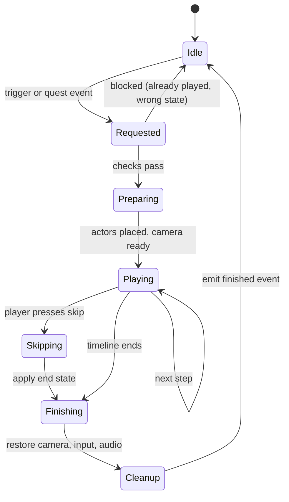

Rules:
- **Preparing** places actors (or fades through black), saves what must be restored, and loads needed assets.
- **Skipping must reach the same end state as watching.** Every cutscene declares an `endState` (positions, quest flags, items, time of day, camera, who is in the vehicle). Skip applies it instantly. This is the most common cutscene bug, so it is tested for every cutscene.
- **Cleanup always runs**, even on error: restore input, camera, HUD, audio levels, and animation states. On error, abort safely, apply the end state, log the bug, and keep the game running.
- **A cutscene can never trap the player.** A watchdog aborts any cutscene exceeding its `maxDuration`.
- Cutscenes play **once** by default, with replay from a menu once seen. "Seen" flags are saved.

## 6.5 What a cutscene script describes
- **Camera:** cut to a shot, pan, dolly, orbit, follow an actor, look at a target, shake, change field of view, return to the gameplay camera
- **Actors:** walk to a point, face a target, play an animation (from the list in Section 10), enter or exit a vehicle, sit, stand, emote, look at
- **Role-based casting:** steps refer to **roles** (`PLAYER`, `FRIEND_1`, `FRIEND_2`, `LECTURER`, `PARENT`), not fixed characters. The Director fills roles from who is present. If a role is missing, use a defined **fallback** (another NPC, or skip the line).
- **Dialogue:** speaker role, text with tokens, duration or "wait for press", mood, optional blip sound
- **Companions:** friends with the player appear in their own positions, seats, and outfits
- **Audio:** music start, stop, change; sound effects; ambience changes
- **Effects:** fades, letterbox, slow motion, flash, rain on or off, time-of-day change, particles
- **World:** open or close doors, spawn or remove props or NPCs, move vehicles
- **Flow:** wait, parallel steps, branch on a flag (for example whether the player has a car), emit an event
- **Meta:** `id`, `skippable`, `maxDuration`, `endState`, `playOnce`, `requires`, `ambient`

Keep scripts **small and readable**: adding a cutscene means writing data, not engine code.

## 6.6 Design practices
1. **Short and purposeful.** Most are 10 to 40 seconds. Only the opening, big story beats, and the finale run longer.
2. **Always skippable** (hold-to-skip or a button, with a hint after a few seconds).
3. **Show, then tell.** Prefer camera and action over long text.
4. **Clear shots:** wide establishing shot, closer shots on the speaker, back to wide. Do not cut too fast.
5. **Smooth handover:** the gameplay camera blends in and out with no jumps.
6. **Readable on a phone:** large captions, safe margins, at least about 15 characters per second reading time (adjustable).
7. **Consistent tone:** funny, warm Nigerian campus life. Keep all text in `docs/STORY_TEXT.md`.
8. **Reward the player:** unlock something, reveal a place, or advance the story.
9. **Accessibility:** captions on, text size option, and a reduced-motion option that removes shake and flashing.
10. **Never block on assets.** If something is not loaded, fade and load, or skip the shot. Never freeze.

## 6.7 Where cutscenes should appear (minimum list)
- [ ] **Opening:** parents drop the player at school, title card using `{{GAME_NAME}}`, first objective
- [ ] **Every major mission:** briefing before, result after
- [ ] **First entry to each key place:** lecture hall, hostel, admin block, Senate building, sculpture garden, dam, market
- [ ] **Vehicle moments:** getting in with friends, arriving at important places
- [ ] **Event moments:** rain starts, power outage, announcements, a surprise test
- [ ] **Ambient cutscenes** while walking (friends calling out, NPC conversations, crowds)
- [ ] **Failure and retry moments** (short, funny, never punishing)
- [ ] **The finale:** the biggest cutscene, with the whole campus and the player's friends, followed by credits

## 6.8 Performance rules
- Scripts are tiny data files, **loaded when needed and unloaded after**.
- Reuse existing models, animations, and sounds. **No video files and no large cutscene-only assets** without my approval.
- Crowds use the same LOD and instancing rules as the world.
- The frame budget still applies. Provide a **low-quality cutscene mode** (fewer extras, simpler effects) used automatically on weak devices.

## 6.9 Testing cutscenes
- [ ] Every cutscene referenced by a quest step exists, and every cutscene file is referenced
- [ ] Every role, animation, sound, location, prop, and vehicle used exists
- [ ] Every cutscene has `endState`, `maxDuration`, and `skippable`
- [ ] **Skip test:** the bot plays each cutscene fully, then loads the same state and skips it. Both must reach the **same end state**
- [ ] **Companion test:** zero, one, and several friends present. No cutscene may break
- [ ] **Outfit and vehicle test:** different outfits and vehicles, no clipping, no missing seats, no heads through roofs
- [ ] **Interruption test:** quit, pause, tab switch, or lose focus mid-cutscene. The game must recover
- [ ] **Save test:** save and load during, just before, and just after each cutscene
- [ ] **Previewer** (admin tools): choose any cutscene, time of day, weather, and companions, then play, step, or scrub the timeline
- [ ] **Text check:** captions fit small screens and tokens resolve, including after a rename

## 6.10 Cutscene workflow

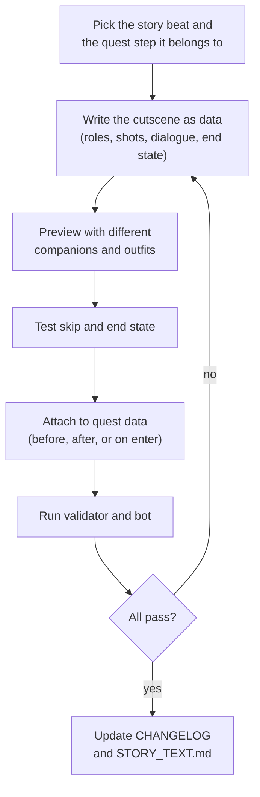

## 6.11 Audit questions for the AI
1. What intro or cutscene code exists? Reuse or replace?
2. How are outfit, vehicle, and companions represented so cutscenes can reuse them?
3. What does it take for the camera to blend smoothly between gameplay and cutscene shots?
4. Which animations are missing for the list in Section 6.7?

---

# 7. DYNAMIC CREDITS

## 7.1 Requirement
Credits are **never hard-coded**. As people help (voice acting, physics help, art, music, testing, translation), the super admin can add, edit, reorder, and remove credits from settings without changing code. The end-of-game credits build themselves from this data.

## 7.2 Data flow

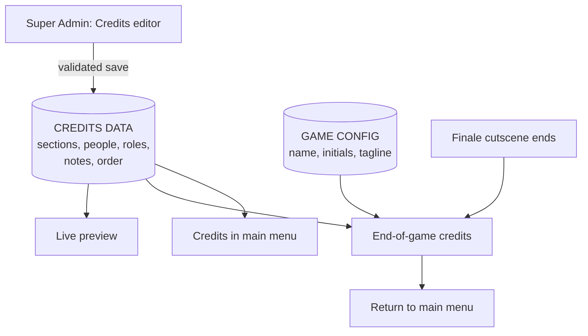

## 7.3 Rules
- **Sections** (for example Created By, Voice Cast, Physics and Engineering, Art, Music and Sound, Testing, Translation, Special Thanks), each with a title, order, and entries.
- **Entry:** `name`, `role` (free text such as "Voiced the lecturer"), optional `note`, `link`, `characterName`, `order`, `visible`, `approved`. A person can have several roles.
- **Editor:** add, edit, delete, drag to reorder, hide without deleting, duplicate, search, **live preview**, and warnings for duplicates or empty fields.
- **Runtime-generated scroll** styled to the game, using the name from config, a generated logo, and the tagline. It must handle zero credits (a short default message), a few, and hundreds without layout problems or slowdowns.
- Playable from the end of the game, from the main menu, and as an admin preview. **Skippable.** Scroll speed adapts to screen size.
- **Same storage approach, history, rollback, and change log as the config** (Section 5.4).
- **Sanitise all text.** Names are user-entered, so never render them as raw HTML.
- **Privacy and consent:** a name appears only with the person's agreement. The `approved` flag keeps entries hidden until confirmed.
- Credits data is checked by the validator (Section 4.6).

---

# 8. FEATURE WORKFLOW, DEFINITION OF DONE, BUG-FIX LOOP

## 8.1 Feature workflow (use for every new feature)

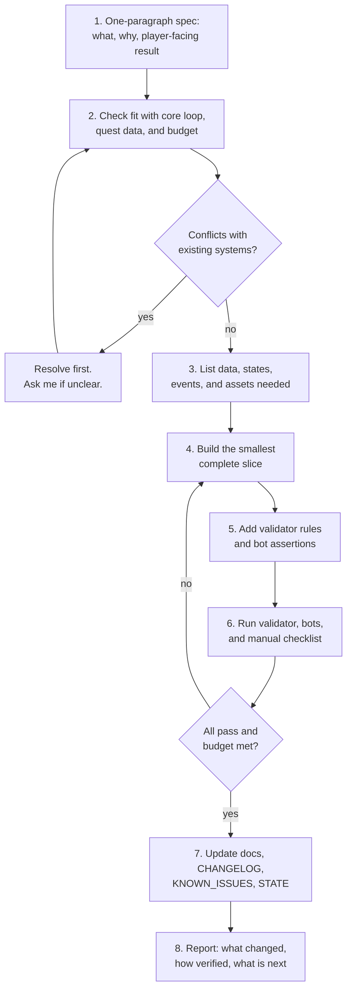

## 8.2 Definition of Done (every feature and fix)
- [ ] Works on a low-end Android phone and on desktop
- [ ] Controls work with touch, keyboard, and gamepad (if supported)
- [ ] No console errors or warnings
- [ ] Validator and bots pass
- [ ] Save and load works mid-feature
- [ ] Animation, sound, and feedback are present (Sections 10, 13, 14)
- [ ] Performance budget met (Section 9)
- [ ] Old behaviour it replaces is removed
- [ ] No hard-coded name, initials, or changeable text
- [ ] Cutscene or reason for none (for missions and new places)
- [ ] Docs updated (`STATE.md`, `CHANGELOG.md`, `KNOWN_ISSUES.md`, `STORY_TEXT.md` where relevant)

## 8.3 Bug-fix loop

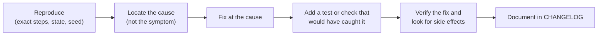

---

# 9. PERFORMANCE BUDGET AND WEB/PWA RULES

| Item | Target |
|---|---|
| First load (compressed) | Under 5 MB. Interactive in under 5 seconds on a mid-range phone over 4G |
| Frame rate | Steady 60 FPS desktop. 30+ FPS on a low-end phone. No frozen frames |
| Frame time | Logic and render under 16 ms (desktop), under 33 ms (low-end) |
| Draw calls | As low as possible. Batch and instance repeated things |
| Memory | No steady growth across a 30-minute session |
| Garbage | No per-frame object allocation in the game loop |
| Battery and heat | No sustained maximum CPU or GPU load on phones. Offer a battery saver mode |

Rules:
- **Fixed timestep** for logic (for example 60 Hz) with interpolated rendering.
- **Object pools** for particles, ripples, rain, birds, projectiles, and sounds.
- **Instancing** for trees, crowds, birds, statues, and props.
- **Culling** of everything off-screen. **LOD** for far characters (fewer limbs, no small-part animation).
- **Chunked world streaming.** Load interiors and distant areas on demand and unload after leaving. Fade or place pop-in beyond view range.
- **Texture atlases** and procedurally generated shapes where possible. Compress audio (Opus or OGG) and use sound sprites.
- **Blob shadows** for NPCs. Real shadows only for the player, if at all.
- **Graphics quality setting** (low, medium, high) scaling particle counts, draw distance, crowd size, and cutscene extras. Detect weak devices and default to low.
- **Pause everything when the tab is hidden** (rendering, audio, timers).
- **Resize and orientation:** handle window resize, phone rotation, and different pixel densities. Cap the render resolution on high-density screens.
- **Storage:** respect browser storage limits. Keep saves small, and handle quota errors and private browsing.
- **PWA:** manifest, service worker with asset caching and versioned cache names, offline play, an update prompt, and a safe path when an update changes the save format. Optional wrappers later (Capacitor for mobile, Tauri for desktop).
- **Profiling:** a debug overlay (FPS, frame time, draw calls, entity counts, memory). Check it after every feature.
- **Asset licensing:** every font, sound, music track, and image must have a recorded licence or source in `docs/DECISIONS.md` or an assets list. No unlicensed assets.

---

# 10. ANIMATION STANDARDS

## 10.1 Principles (the ones that matter for a light, blocky character)
1. **Anticipation:** a small wind-up before big actions (crouch before a jump, pull-back before a punch).
2. **Follow-through and overlap:** parts settle after the main motion (arms, head, clothes lag slightly).
3. **Squash and stretch:** very small scale changes on landing and jumping.
4. **Ease in and out:** no linear motion for body parts.
5. **Arcs:** limbs and head move in curves.
6. **Timing:** quick actions feel light, slow ones feel heavy. Tune by feel.
7. **Exaggeration:** push poses slightly further than real life so they read at small size.
8. **Secondary action:** blinking, breathing, a head turn toward interesting things.
9. **Readability:** every action reads from its silhouette.

## 10.2 Technical rules
- **Procedural first.** Sine-based walk and run cycles and spring-based secondary motion instead of heavy keyframe data.
- **Match speed to movement:** the cycle speed follows actual ground speed so feet never slide.
- **Blend, never snap.** Blend between states in 100 to 200 ms (shorter in combat). Higher-priority animations interrupt lower ones (Hit beats Walk).
- **Layering:** locomotion on legs and torso, upper-body actions (punch, wave, hold phone) layered on top.
- **One owner per body part per frame.** Resolve conflicts with priorities, never by overwriting.
- **Animation events:** footstep sounds, hit frames, and door-open frames fire from named events in the animation, not from separate timers.
- **Hit-stop** (about 50 to 80 ms freeze) plus a small camera shake for hits and punches.
- **Root motion vs in-place:** choose one per animation and document it.
- **Cutscene compatibility:** every animation can be triggered by a cutscene step and can be forced to its end pose (needed for skip).

## 10.3 Animation checklist
Each needs a start, a body or loop, an end, a sound, and a test.
- [ ] Idle (breathing, looking around, impatient shift after a while)
- [ ] Walk, run, sprint, stop (slight skid), turn in place
- [ ] Jump, fall, land (soft and hard)
- [ ] Stumble, fall down, lie, get up
- [ ] Sit down, sit idle, stand up (chairs, benches, lecture seats)
- [ ] Punch, get hit (light and heavy), knock-back, recover
- [ ] Enter car, drive, exit car (every seat, both sides)
- [ ] Bicycle: mount, pedal (legs linked to the wheel), steer, dismount
- [ ] Enter and exit building (door animation, transition, sound)
- [ ] Friends: follow, wait, enter and exit your vehicle, sit in their seats
- [ ] Swim (surface), dive, surface, breath gasp, drown
- [ ] Emotes and reactions (laugh, wave, shock, tired)
- [ ] NPC idle, walk, talk gestures

---

# 11. PHYSICS AND COLLISION CHECKS

## 11.1 Clothing and limbs (feet and legs clipping when running)
- Clothes are **separate layers slightly larger than the body** (about 1.05 to 1.1 times) so limbs never poke through.
- Limit joint ranges (for example leg swing about 35 degrees walking and 50 degrees running) so limbs cannot rotate through clothing.
- Trousers, skirts, and long clothing follow the legs with **spring-lag** and are clamped so feet never show through the hem.
- Draw order and depth are consistent: body, clothing, shoes, accessories. Test every outfit with every animation.
- Add a debug mode that colours body and clothing separately to spot clipping.

## 11.2 Vehicles
- Every vehicle defines: **seat anchors** (position, rotation, pose), **door anchors**, **roof height**, **interior mesh**, and **wheel radius**.
- **Head clearance rule:** seat height + seated torso + head must be less than roof height. The validator fails if not.
- The interior is drawn: a dark interior box, seats, dashboard, and steering wheel. **No invisible or empty seat areas.**
- Draw order: body, interior and seats, player, windscreen and frame on top.
- **Wheels:** rotation = distance travelled divided by wheel radius. Front wheels also turn with steering.
- **Steering wheel** rotates with steering input (about 90 degrees each way), and the driver's hands follow it.
- **Horn:** a sound that plays while held, with a small reaction from nearby NPCs and birds.
- Passengers use the same anchor system. The player cannot enter a full seat.
- While seated, the player collider is off and the vehicle collider is used.
- Bicycles: spinning wheels, pedal-linked legs, steering that moves the handlebars.

## 11.3 World collision
- Use simple shapes (boxes, circles) for collision, never the render mesh.
- A spatial grid or similar broad-phase so collision cost does not grow with world size.
- **No falling through the ground:** clamp to terrain height, and teleport to the last safe position if the player goes below the world.
- **No getting stuck:** if movement input is held but position has not changed for 1 to 2 seconds, nudge the player out along the collision normal.
- Doors, stairs, and ramps have explicit trigger zones and step-height rules.

## 11.4 Water
- Entering water triggers a splash (particles, ripple, sound) from a pool.
- Swimming has its own speed, buoyancy, and animation states.
- **Breath meter:** drains underwater at a set rate (for example 20 to 30 seconds), refills at the surface, and warns visually and by sound when low.
- Friends swim with you using the same follow logic as on land.
- Underwater: fog, tint, bubbles, and muffled audio. No expensive volumetric effects.

---

# 12. ENVIRONMENT STANDARDS

## 12.1 What a good environment needs
- **Sky:** day and night cycle, moving clouds, sun and moon, and a few birds (instanced or simple boids).
- **Weather:** rain with splash particles, wet ground, a darker sky, changed ambient audio, and puddles. Optional harmattan haze and dust.
- **Life:** students walking between buildings, hawkers, bikes and tricycles, generators, queues and crowds, with busy and quiet times of day.
- **Ambience:** wind in trees, birds, distant crowd, music from shops or hostels, and rooms that sound different inside.
- **Surfaces:** footstep sounds and dust by surface (tile, grass, sand, wet).
- **Landmarks and wayfinding:** each area is distinct and recognisable from afar. Use light, colour, and signage (generated from config) to guide the player. Do not rely on the arrow alone.
- **Points of interest:** something worth seeing every 30 to 60 seconds of walking.
- **Small details:** flags, posters, hanging clothes, stray animals, and scattered objects that make places feel lived in.

## 12.2 Sculpture garden
- Statues of people, animals, and frogs in a readable layout with paths and benches.
- Simple blocky models, instanced where repeated.
- Small interactions: a frog hops when you approach, a plaque with a funny line, a photo spot.
- A calm audio mood (birds, water, soft music).
- Signs use sign slots (Section 5.3).

## 12.3 Dam and swimming area
- Rules in Section 11.4.
- A diving spot, a shallow area, a deeper area with warnings, and a shoreline with props.
- Ripples from entries, character movement, and rain. Draw ripples as pooled sprites over a simple scrolling-texture water surface.

## 12.4 Environment checklist
- [ ] Day, night, and weather transitions are smooth and cheap
- [ ] Birds, clouds, and rain use pooled or instanced implementations
- [ ] Every area has a unique silhouette, colour, and sound
- [ ] NPC and vehicle counts scale with the quality setting
- [ ] Nothing visibly pops in or out
- [ ] Signs show the current name and initials from config

---

# 13. GAME DESIGN PRACTICES

## 13.1 Core loop and player experience
- Define the **core loop** in one sentence (for example: take a goal, travel across campus, interact, get rewarded, unlock the next goal). Every feature must serve it.
- **A clear goal at all times.** The player can answer "what am I supposed to do?" in 3 seconds. Objective HUD, guide, and map always agree.
- **Teach by doing.** Introduce one mechanic at a time in a safe place, then combine.
- **Feedback for every action** within 100 ms: animation, sound, particles, and a UI response.
- **Fairness:** no unexplained failures. Show the cause.
- **Short sessions:** playable and saveable in 5-minute chunks, because many players are on phones.
- **Checkpoints and autosave** at every quest step and area change.

## 13.2 Story and quest design
- Every step has a **goal, location, trigger, reward or consequence, and text for guide, map, and dialogue** from the same data.
- Clear **order and dependencies** (`requires`, `next`), tested by the validator.
- Optional side activities never break or block the main story.
- Consistent tone: funny, relatable Nigerian campus life (sapa, hostel wahala, registration queues, lecture rush).
- All text lives in `docs/STORY_TEXT.md` and the text data files so consistency can be reviewed in one place.
- Cultural care: keep humour affectionate and avoid stereotypes that mock groups of people. Review sensitive jokes before they ship.

## 13.3 Open world design
- **Districts around a hub:** hostels, lecture halls, admin, market, sculpture garden, dam.
- **Travel must be fun:** vehicles, shortcuts, and things to see. No long empty stretches.
- **Fast travel** or quick vehicle summon once the world is learned.
- **Soft guidance:** arrow, map, landmarks, NPC hints. No hard walls without a reason.
- Mini-map and full map always match the current objective and known places.

## 13.4 UI and controls
- Mobile-first: large touch targets, joystick and buttons, readable text.
- Keyboard and gamepad support. Rebindable keys if possible.
- **Contextual prompts** ("Press E to enter car") appear only when relevant.
- Consistent HUD: objective, health or energy, breath (when swimming), and money (the sapa meter).
- Settings: volume, quality, controls, text size, reduced motion, captions, and (later) language.
- **Accessibility basics:** adequate contrast, text scaling, no information conveyed by colour alone, and no flashing effects beyond safe limits.

## 13.5 Systems that fit the theme (add only after the core is stable)
- Sapa meter (money and energy pressure), food, transport costs, small jobs.
- Grades, lectures, and attendance as quests and consequences.
- Friends and relationships with simple rules (follow, hang out, help).
- Random campus events (rain, power outage, protest, surprise test).
- Collectibles and achievements with a funny voice.

---

# 14. AUDIO

- Every action has a sound: footsteps by surface, hit, punch, door, car, horn, splash.
- Mix: music lower than effects, with ducking during dialogue and cutscenes.
- Audio is loaded lazily, pooled, and capped (maximum simultaneous sounds).
- Browsers unlock audio only after the first user input. Handle this explicitly with a clear first-tap prompt.
- Character "blip" sounds for dialogue, pitch-shifted per character.
- Optional recorded voice lines later: small compressed files, off-switch in settings, and credited in the credits data.
- Respect the device mute switch and the tab visibility (pause audio when hidden).

---

# 15. TESTING

## 15.1 Layers
1. **Validator** (Section 4.6): data consistency, run on every dev load and in CI.
2. **Debug API** (`window.__test`, dev only): `teleportTo(zone)`, `getState()`, `getObjective()`, `press(key)`, `advanceDialogue()`, `setTime(t)`, `setWeather(w)`, `spawnVehicle(id)`, `playCutscene(id)`, `skipCutscene()`, `setConfig(patch)`, `setSeed(n)`.
3. **Scripted bot:** plays level 1 in order. After every step it asserts that objective text, guide arrow, map marker, and `currentStepId` all agree, and that the step advances within a time limit. It also plays every cutscene and tests skip.
4. **Monkey bot:** random inputs for several minutes with a logged seed. Reports crashes, soft-locks (no progress for N seconds), falling through the world, and stuck states.
5. **Save and load test:** save at every step and around every cutscene, reload, and confirm the game continues correctly. Also test an **old-version save**.
6. **Rename test:** change the config name and initials mid-game and confirm every sign, menu, caption, and credit updates.
7. **Visual checks:** screenshot comparison for key poses (seated in each car, running in each outfit, swimming, signs with long and short names).
8. **Performance test:** a 10-minute session recording FPS, frame time, and memory against the budget.
9. **Manual checklist** for feel: animation quality, audio, readability on a phone.
10. **Browser Playwright (or similar) runner** to open the game, run the bots, collect console errors, screenshots, and video, and write a JSON and markdown report with one command.

## 15.2 Test flow

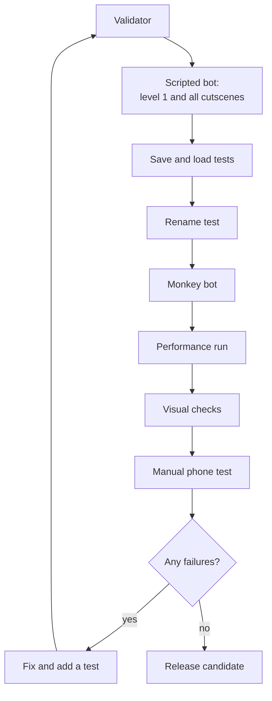

## 15.3 Bug report format (bots and humans)
- **ID, severity** (blocker, major, minor), **area**
- **Steps to reproduce**, **seed**, and **game state dump** (step ID, position, player state, time, weather, config version)
- **Expected vs actual**
- **Screenshot or short video**
- **Console errors**
- **Suspected cause** (if known)

## 15.4 AI playtesting
A vision-capable AI model driving the browser can be used later for a "does this make sense to a new player" pass (for example when guide arrow and map seem to point different ways). It is slower, costs more, and is less repeatable than scripted bots, so use it as a final review only. The scripted bot, monkey bot, and validator come first.

---

# 16. WORKING PROTOCOL (HOW THE AI MUST REPLY)

## 16.1 Reply structure for every task
1. **Understanding:** what you think the task is, in 2 to 3 lines. Ask only if something truly blocks you.
2. **Findings:** what is wrong or missing now, with file and line references.
3. **Plan:** the exact files you will change, in order.
4. **Changes:** the complete changed files (Section 1.3 rule 5).
5. **Verification:** which validator rules, bot checks, and manual checks you ran or added, and the results. Say plainly what you could not run.
6. **Risks and follow-ups:** anything left, and anything you were unsure about.
7. **Doc updates:** what you changed in `STATE.md`, `CHANGELOG.md`, and `KNOWN_ISSUES.md`.

## 16.2 Never do
- Keep two versions of the same system "just in case."
- Hard-code a destination, ID, name, initials, or text that exists in data.
- Skip the validator or the budget check.
- Add a feature that does not serve the core loop without asking me.
- Leave a TODO that is not in `KNOWN_ISSUES.md`.
- Claim something is fixed without saying how it was verified.
- Truncate a file or replace code with a comment like "rest of file unchanged."
- Change the save format without a version bump and a migration.

---

# 17. SCOPE CONTROL AND RISK REGISTER

## 17.1 Priorities (MoSCoW)
| Priority | Items |
|---|---|
| **Must** | Audit, consolidation, single source of truth, dynamic config, flow fix, versioned saves, validator, scripted bot, car seat and clipping fixes |
| **Should** | Cutscene Director with opening and mission cutscenes, credits system, animation checklist, performance budget, PWA |
| **Could** | Sculpture garden, dam and swimming, rain and birds, ambient cutscenes, recorded voice lines, finale polish |
| **Later** | Translation, extra theme systems (sapa meter depth, grades), backend admin if not chosen at first, gamepad rebinding |

## 17.2 Scope rules
- Build a **vertical slice** first: one mission, from opening cutscene to mission end, fully correct and within budget, before widening.
- A new idea goes to `docs/DECISIONS.md` as "proposed" with a size estimate (small, medium, large) and what it would displace.
- Do not start a "Could" item while a "Must" or "Should" item is open without my approval.

## 17.3 Risks
| Risk | Why it matters | Mitigation |
|---|---|---|
| Old and new level-1 code keep mixing | Causes the stuck and wrong-destination bugs | Phase 0 audit, tagged backup, delete dead code, loud failures on old IDs |
| Hard-coded name or text creeps back | Breaks the dynamic name and consistency | Validator rule, token system, review in every task |
| Skip leaves the game in the wrong state | Soft-locks and broken story | `endState` required, skip test on every cutscene |
| Performance drifts down over time | Game becomes unplayable on cheap phones | Budget, overlay, 10-minute performance runs, quality settings |
| Admin tools exposed to players | Anyone could change branding and credits | Section 5.4 approach, no secrets in front-end code, logged changes |
| AI loses context between sessions | Drift and duplicated work | `STATE.md`, session protocol, `DECISIONS.md` |
| Save format changes break progress | Players lose progress | Save versions and migrations, old-save test |
| Scope growth (months of development) | Project never reaches a playable release | MoSCoW, vertical slice, scope rules |
| Unlicensed assets or credits without consent | Legal and trust problems | Asset list with licences, `approved` flag on credits |

---

# 18. KICKOFF MESSAGE

Copy this to the AI to start.

> Read `MASTER_GAME_GUIDE.md` fully. Confirm in a few lines that you understand the rules, the phases and approval gates, the single-source-of-truth requirement, dynamic config (no hard-coded name or initials), code-driven cutscenes, dynamic credits, the session protocol, and the "complete files only" rule. Then start **Phase 0 only**: audit the whole codebase and write `docs/AUDIT.md` covering every item in Section 2.1 and the questions in Sections 5.8 and 6.11. Create `docs/STATE.md`, `CHANGELOG.md`, and `KNOWN_ISSUES.md` if they do not exist. Do not change any game code yet. When finished, give me: (1) the ranked list of conflicts between old and new level-1 code, (2) the answers to the audit questions, (3) your proposed cleanup plan, (4) the smallest first slice, and (5) anything in this guide you think is unclear, wrong, or too heavy for the project. Wait for my approval before Phase 1.

---

# APPENDIX A. NAME IDEAS

These are suggestions only. The name is changed in config, never in code.

- **Sapa Life: Fresher Wahala**
- **Fresher Wahala**
- **Campus Gbedu**
- **Jand Life**
- **Omo School**
- **Aluta Life**
- **No Light, No Problem**
- **Hostel Lord**
- **Freshers School Life Game** (current working name)

# APPENDIX B. GLOSSARY

| Term | Meaning |
|---|---|
| **Single source of truth** | One place where a fact lives. Everything else reads it |
| **Token** | A placeholder such as `{{GAME_NAME}}` replaced at runtime from config |
| **Sign slot** | A data entry describing where a sign is, its size, and what it displays |
| **Quest Manager** | The only system that changes the current story step |
| **Director** | The system that plays a cutscene timeline |
| **End state** | The exact game state after a cutscene, applied instantly when skipped |
| **Ambient cutscene** | A cutscene that plays while the player keeps control |
| **Role (casting)** | A cutscene placeholder such as `FRIEND_1` filled by whoever is present |
| **Validator** | A check that scans game data and fails loudly on inconsistency |
| **Debug API** | Dev-only functions that let bots control and inspect the game |
| **Monkey bot** | A bot that plays randomly to find crashes and soft-locks |
| **LOD** | Level of detail: simpler models and animation at a distance |
| **Pool** | Reused objects to avoid memory allocation during play |
| **PWA** | Progressive web app: installable and works offline |
| **Vertical slice** | One small part of the game finished to final quality |
