# MASTER_GAME_GUIDE.md (Version 2)

**Master prompt, design rulebook, and engineering standard for the open-world Nigerian university-life web game, now being extracted from Django, rebuilt as a standalone TypeScript project, and moved to a modern web game engine.**
(Current working name: **Freshers School Life Game**, initials **FSLG**. The name is dynamic, see Section 5. Never hard-code it.)

> **How to use this file**
> 1. Put it in the root of the new project. It replaces `MASTER_GAME_GUIDE.md` (version 1), `GAME_GUIDE.md`, and `GAME_GUIDE_ADDENDUM.md`. Delete those to avoid conflicting copies.
> 2. Start every new AI session with: **"Read MASTER_GAME_GUIDE.md fully, then read docs/STATE.md. Follow both for every task."**
> 3. To begin, send the kickoff message in Section 27.
> 4. Suggested model roles (a workflow suggestion, not a rule): a planning-and-iteration model owns audits, architecture, and reviews; a graphics-focused model owns final visuals. Whoever works on a task follows this same file.

## What changed in version 2
- The game is **copied out of the Django project** into a standalone, front-end TypeScript project. **Nothing in Django is deleted or modified.** (Section 18)
- A **temporary local SQLite database** is used for development, behind a data layer that can later swap to Supabase or another database. (Section 21)
- A **web game engine** (PlayCanvas or Babylon.js) replaces the custom renderer, chosen by a **bake-off prototype**, with **before and after screenshots** and an honest capabilities and limits report. (Section 20)
- A **platform layer** lets one game run on the website, portal demos, and an offline app without knowing where it runs. (Section 22)
- **Live operations:** event calendar, remote config, kill switches, in-game devlog, and reward slots (switched off for now). (Section 23)
- **Website and deployment** on Cloudflare, with streamed content packs and offline play. (Section 24)
- An **admin dashboard and multi-game platform** so many games can be controlled in one place. (Section 25)
- **Marketing capture tools, community mission data format, and monetization readiness** (everything ad-free for now). (Section 26)
- The phase plan is rebuilt around these changes. (Section 2)

## Table of contents
1. The prompt (role, situation, non-negotiable rules)
2. Phases and approval gates
3. Session protocol, git discipline, folder structure
4. Architecture rules (single source of truth, state machines, events, validator)
5. Dynamic game config (name, initials, branding, super admin)
6. Code-driven cutscenes
7. Dynamic credits
8. Feature workflow, Definition of Done, bug-fix loop
9. Performance budget and web/PWA rules
10. Animation standards
11. Physics and collision checks
12. Environment standards
13. Game design practices
14. Audio and voices
15. Testing (validator, bots, reports)
16. Working protocol (how the AI must reply)
17. Scope control and risk register
18. Extracting the game from Django (copy, never delete)
19. Tech stack and repository layout
20. Engine decision, migration, and graphics comparison
21. Data layer: SQLite now, Supabase or other later
22. Platform layer and portal edition
23. Live operations (events, remote config, devlog, reward slots)
24. Website, deployment, and offline packs
25. Admin dashboard and multi-game platform
26. Marketing tools, community missions, and monetization readiness
27. Kickoff message
Appendix A. Name ideas
Appendix B. Glossary
Appendix C. Asset and voice sources (licences must be checked)
Appendix D. Beginner run guide requirements

---

# 1. THE PROMPT

## 1.1 Role
You are the lead engineer, game designer, animator-technician, and QA lead on an open-world, Nigerian university-life game. It currently lives inside a **Django project** and runs in the browser on a **custom JavaScript engine**. It is being **copied out into a standalone, front-end TypeScript project** and moved onto a modern web game engine (PlayCanvas or Babylon.js, decided by a bake-off). It must stay light, stream its content in packs, and be installable and playable offline (PWA).

## 1.2 Situation
- The game already works. **Level 1 was rewritten, and old and new features are now mixed together.**
- Known problems:
  - the game flow gets stuck or sends the player to the wrong place
  - story text, guide text, and map markers disagree about where to go
  - animation and physics glitches: feet and legs clip through clothes when running, heads poke through car roofs, cars have no seats, and the seated player is invisible
- The name of the game will change, so it must be dynamic everywhere.
- The game is being **extracted from Django by copying**. The Django project is kept untouched as a backup (Section 18). The new project is TypeScript, front-end only, with a temporary local SQLite database that can later move to Supabase or another database (Section 21).
- The goal is a **much better-looking, more alive game** on a web engine, with an honest before-and-after comparison and capabilities report (Section 20).
- The game will ship on my own website (Cloudflare), as **portal demos**, and as an installable offline app, and **many more games** will follow on the same platform (Sections 22 to 25).
- Everything is **free and ad-free for now**. Monetization is prepared for but switched off (Section 26).
- The game needs code-driven cutscenes, dynamic credits, and a strict, testable story flow.
- Your job: **make the existing game consistent and correct first, then add features under the rules below.**

## 1.3 Non-negotiable rules
1. **No new features until Phases 0 to 3 are done and verified.**
2. **One source of truth.** Quest steps, destinations, map markers, guide text, dialogue, and cutscene triggers all derive from one data definition. No system hard-codes a destination.
3. **Nothing that will change is hard-coded.** Game name, initials, tagline, mission names, NPC names, currency label, credits, and story text live in data and use tokens (Section 5).
4. **Never silently guess.** If code is ambiguous, old, or duplicated, list it in the audit and ask before deleting. Never leave dead code behind.
5. **Complete files only.** When you change a file, output the complete file. Never write "rest unchanged", "...", or a summary in place of code. If a reply would be too long, split the work **by file across several replies**, finish each file completely, and say which files remain.
6. **Every change ships with a check:** a validator rule, a bot assertion, or a manual checklist item.
7. **Respect the performance budget** (Section 9). A feature that breaks the budget is not done.
8. **Report before and after.** For every task: what was wrong, what you changed, how it was verified.
9. **Maintain the project documents** (Section 3.4) on every task, especially `docs/STATE.md`, `CHANGELOG.md`, and `KNOWN_ISSUES.md`.
10. **Disagree out loud.** If a request conflicts with a rule here, say so, explain the trade-off, and propose an alternative. Never silently break a rule, and never silently skip a request.
11. **Never claim something is fixed or working unless you say how you verified it.** If you could not run or test something, say so plainly.
12. **Protect the player's progress.** No change may corrupt or silently discard saves. Use versioned saves and migrations.
13. **Never modify or delete the Django project.** Copy from it, read from it, export from it. Do not run migrations, resets, or deletes against it or its database.
14. **Never copy secrets or real personal data.** No keys, passwords, tokens, or `.env` contents in the new project or in documents. Use placeholders and `.env.example`.
15. **Never invent results.** Screenshots, benchmarks, test results, and measurements must come from real runs. If something could not be run or captured, say so and give me the steps to do it myself.
16. **Verify anything that changes over time** (hosting limits, portal rules, licences, pricing, library versions) at the moment you rely on it, and record the date checked.

## 1.4 Precedence when instructions conflict
1. My latest explicit instruction in the chat (but you must still flag any rule it breaks, see rule 10)
2. This file
3. Existing code conventions
4. Your own preferences

---

# 2. PHASES AND APPROVAL GATES

Work in order. **Do not start a phase until I approve the previous phase's report.** Each phase ends with a short report: what was done, how it was verified, what is risky, and what comes next.

```mermaid
flowchart LR
    P0["Phase 0<br/>Audit and<br/>Django inventory"] --> G0{"Gate"}
    G0 --> P1["Phase 1<br/>Extract to standalone<br/>TypeScript project"]
    P1 --> G1{"Gate"}
    G1 --> P2["Phase 2<br/>Consolidate and<br/>dynamic config"]
    P2 --> G2{"Gate"}
    G2 --> P3["Phase 3<br/>Flow fix, quest manager,<br/>validator, bots"]
    P3 --> G3{"Gate"}
    G3 --> P4["Phase 4<br/>Engine bake-off and<br/>graphics comparison"]
    P4 --> G4{"Decision gate"}
    G4 --> P5["Phase 5<br/>Migrate to chosen engine,<br/>fix animation and physics"]
    P5 --> G5{"Gate"}
    G5 --> P6["Phase 6<br/>Cutscenes, credits,<br/>platform layer, live ops"]
    P6 --> G6{"Gate"}
    G6 --> P7["Phase 7<br/>Website, deployment,<br/>packs, portal edition"]
    P7 --> G7{"Gate"}
    G7 --> P8["Phase 8<br/>Environment, polish,<br/>marketing tools"]
    P8 --> G8{"Gate"}
    G8 --> P9["Phase 9<br/>New features and<br/>new games"]
```

| Phase | Goal | Done when |
|---|---|---|
| **0. Audit and Django inventory** | Map every game system, duplicate, hard-coded string, and old/new conflict. Inventory everything in the Django project that belongs to the game (Section 18). Capture **"before" screenshots** of the current game. **No code changes.** | `docs/AUDIT.md`, `docs/DJANGO_INVENTORY.md`, and `docs/graphics/before/` exist and are reviewed by me |
| **1. Extract** | Copy the game, its settings, its admin panels, and its data into a **new standalone TypeScript project** with a local SQLite dev database and a beginner run guide. **Django stays untouched.** | The extracted project runs on my machine with one command, passes parity checks against the Django version, and `docs/RUN_GUIDE.md` works for a beginner |
| **2. Consolidate and dynamic config** | Remove old level-1 leftovers. Create the game state machine, event bus, config object, and token system. Replace every hard-coded name and initial. | Validator passes. No dead references. Renaming in config updates everything live |
| **3. Flow fix** | Story, guide, map, and triggers all read from quest data. Add versioned saves, the debug API, the scripted bot, and the monkey bot. | Bot completes level 1 start to finish with zero mismatches. Save and load works at every step |
| **4. Engine bake-off** | Prototype one scene (player, a car with seats, the sculpture garden) in **both PlayCanvas and Babylon.js**, measure, and produce the **graphics comparison and capabilities report** (Section 20). | `docs/ENGINE_DECISION.md` and `docs/graphics/` comparison exist. **I make the engine decision.** |
| **5. Migrate and fix animation and physics** | Move the game onto the chosen engine behind the renderer interface. Fix cloth clipping, car seats, head clearance, wheels, steering, horn, water, collisions (Sections 10 and 11). | Every item in the animation and physics checklists passes on the new engine |
| **6. Cutscenes, credits, platform layer, live ops** | Build the Cutscene Director and credits (Sections 6 and 7), the platform adapters (Section 22), and the event calendar, remote config, devlog screen, and reward slots (Section 23). | Skip and end-state tests pass. Build targets run. Event calendar works with no code change |
| **7. Website, deployment, packs, portal edition** | Build the website, content packs, offline play, and the portal demo build (Sections 22 and 24). | Deployed to Cloudflare. Pack streaming and offline play verified on a real phone |
| **8. Environment, polish, marketing tools** | Sky, weather, life, sculpture garden, dam, audio mix (Sections 12 and 14), photo mode, and clip mode (Section 26). | Environment checklist passes. Budget met on a low-end phone |
| **9. New features and new games** | One at a time, each through the feature workflow (Section 8). New games reuse the platform (Section 25). | Each feature passes the Definition of Done |

**Note on ordering:** story, config, and data work is done *before* the engine move because it is engine-independent. Animation and physics fixes are done *after* the move so that nothing is fixed twice. If a bug blocks testing earlier, fix it minimally and log it in `KNOWN_ISSUES.md`.

## 2.1 Phase 0 audit must include
- A list of all files and what each does
- Every place a destination, objective, location ID, or marker is written (story, guide, map, triggers, dialogue)
- Duplicate or conflicting systems (old vs new level-1 code, two quest systems, two spawn systems, and so on)
- Every place the game name, initials, logo, or old names appear (code, textures, manifest, page title)
- Existing intro, cutscene, and credits code, and whether it can be reused
- How the player's outfit, vehicle, and companions are represented
- Every global variable and piece of shared mutable state
- Save and load format, and whether it has a version
- Current performance numbers: load size, FPS, frame time, memory, draw calls, on desktop and on a low-end phone if available
- A ranked list of bugs with causes where known
- A list of everything likely to change that is currently hard-coded
- **The full Django inventory** (Section 18.2)
- **"Before" screenshots** (Section 20.3)
- The answers to the questions in Sections 5.8 and 6.11
- A proposed cleanup plan and a **smallest first slice**

---

# 3. SESSION PROTOCOL, GIT DISCIPLINE, FOLDER STRUCTURE

## 3.1 Why this section exists
An AI assistant can lose context between sessions, and a long project drifts. These rules keep every session consistent.

## 3.2 Session protocol
**At the start of every session**
1. Read `MASTER_GAME_GUIDE.md` and `docs/STATE.md`.
2. Say in 3 lines what phase we are in, what was last done, and what is next.
3. Confirm the task, and flag any conflict with this file before starting.

**At the end of every session**
1. Update `docs/STATE.md` (current phase, what was done, open problems, next 3 tasks, any decisions I made, files touched).
2. Update `CHANGELOG.md` and `KNOWN_ISSUES.md`.
3. Give me a short handoff block I can paste into the next session if the AI does not have project access.

## 3.3 Git discipline
- Work on branches (`phase-1-config`, `fix-car-seats`, and so on). Never work directly on `main`.
- **Tag a backup before any refactor** (for example `before-phase-1`).
- Small, focused commits with clear messages. One concern per commit.
- No generated or build output committed unless needed. Add a sensible `.gitignore`.
- Never delete large areas of old code without first confirming in the audit that nothing still references it.
- Keep a rollback path: any phase can be reverted by returning to its tag.

## 3.4 Project documents (create and keep current)
| File | Purpose |
|---|---|
| `docs/AUDIT.md` | Phase 0 audit |
| `docs/STATE.md` | Current phase, last done, next tasks, decisions |
| `docs/ARCHITECTURE.md` | Systems and diagrams (keep diagrams current) |
| `docs/STORY_TEXT.md` | All player-facing story text and cutscene captions in one place |
| `docs/DECISIONS.md` | Short log of important decisions and why |
| `CHANGELOG.md` | What changed and why |
| `KNOWN_ISSUES.md` | Open bugs and limitations. Every TODO in code appears here |
| `tests/` | Validator, bots, checklists |
| `docs/DJANGO_INVENTORY.md` | Everything in Django that belongs to the game |
| `docs/EXTRACTION_PARITY.md` | Django feature to new feature status list |
| `docs/ENGINE_DECISION.md` | Bake-off results and the engine decision |
| `docs/ENGINE_CAPABILITIES.md` | What we can and cannot achieve |
| `docs/GRAPHICS_COMPARISON.md` | Before and after screenshots with assessment |
| `docs/PORTALS.md` | Each portal's rules, with the date checked |
| `docs/MARKETING.md` | Content calendar and scripts |
| `docs/RUN_GUIDE.md` | Beginner run guide (Appendix D) |
| `assets/ASSET_LICENSES.md` | Source and licence of every asset |

## 3.5 Repository layout
See Section 19.2 for the full monorepo layout (apps, packages, content, assets, docs, tests, scripts). Keep the separation of **engine, game data, content, and tools**, and keep each game in its own folder.

## 3.6 Naming and ID conventions
- All IDs are strings defined **once** in constants or data files. No magic strings elsewhere.
- Use clear, consistent patterns: `loc_main_gate`, `step_register`, `cut_intro_dropoff`, `veh_keke_01`, `snd_horn_car`.
- Old IDs from the previous level 1 are renamed or removed so stale references **fail loudly**.

---

# 4. ARCHITECTURE RULES

## 4.1 Single source of truth for the story

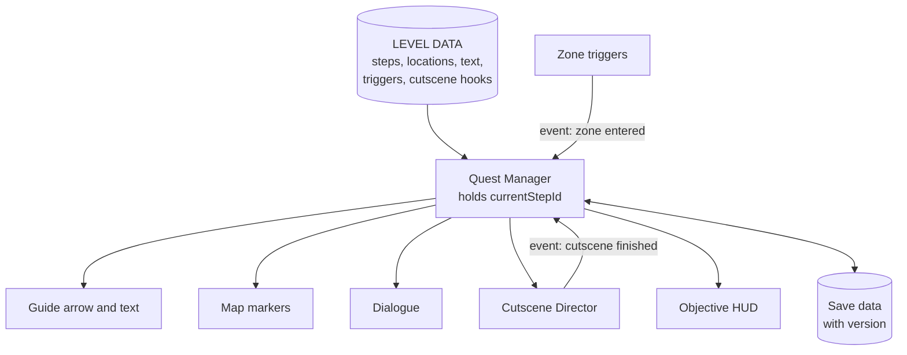

Rules:
- Only the Quest Manager changes `currentStepId`.
- Guide, map, HUD, dialogue, and cutscenes **read** from it. They never decide where the player goes.
- If any of them disagree, the bug is in the data or the reader. Never "fix it in that one place."
- Every quest step has: `id`, `title`, `location`, `marker`, `guideText`, `requires`, `completeWhen`, `next`, and optional `cutsceneBefore`, `cutsceneAfter`, `cutsceneOnEnter`. All text uses tokens (Section 5).
- A step may not send the player somewhere the story has not yet introduced.

## 4.2 System overview

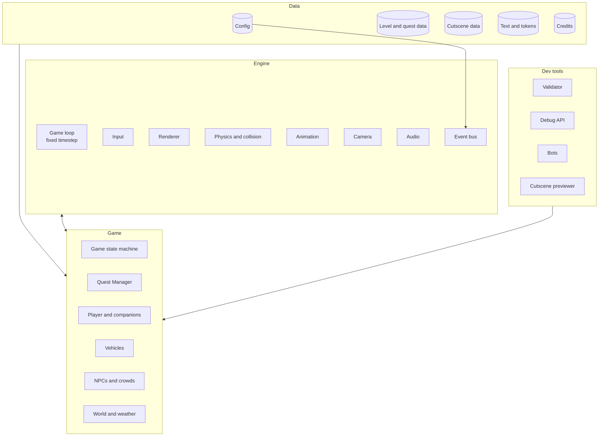

## 4.3 Game state machine

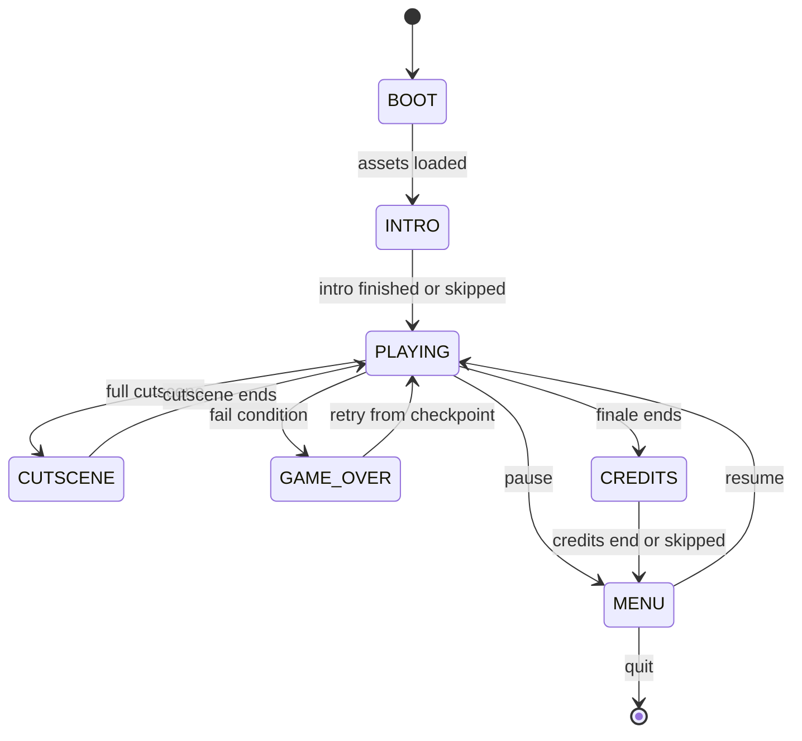

- Only these transitions are legal. Any other logs an error and is ignored.
- Every state has `enter()` and `exit()` that clean up input handlers, timers, audio, and camera.
- Gameplay input is disabled outside `PLAYING`. Ambient cutscenes run **inside** `PLAYING` (Section 6).

## 4.4 Player state machine

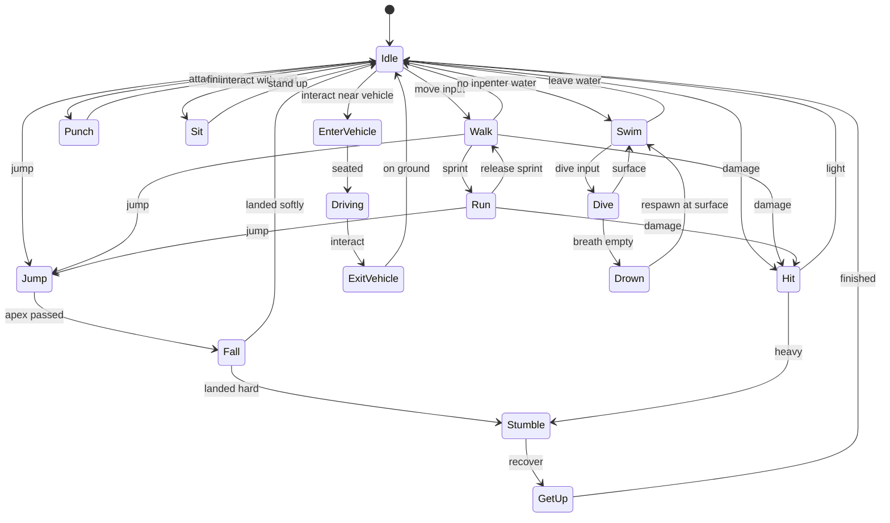

- Each state declares what it **allows** (move, jump, interact) and what it **blocks**.
- Transitions are explicit. No animation is triggered by checking ad-hoc flags.
- Companions use the same state machine so they can sit, ride, swim, and fall too.

## 4.5 Consistency rules
- **Events over direct calls.** Systems communicate through a small event bus (for example `emit('zone:entered', id)`), not by reaching into each other.
- **No hidden globals.** Shared state lives in one `GameState` object.
- **Deterministic update order each frame:** input, state machines, physics, animation, camera, audio, render.
- **Save version:** every save has `saveVersion`. On load, migrate or reset with a clear message. Never load old data into new structures silently. Saves never contain the game name.
- **Seeded randomness** for anything random that bots must reproduce (crowds, weather, events). Log the seed in bug reports.
- **Dev and production flags.** Debug API, validator overlays, and admin tools are available only in dev builds or behind real authentication (Section 5.4).
- **Errors never freeze the game.** Catch errors at system boundaries, log them with context, and recover to a safe state.

## 4.6 Validator (runs on every dev load and in CI)
Must check, and fail loudly on:
- Every step's `location` and `marker` exists on the map
- Every `next`, `requires`, and cutscene reference points to something real
- Every step is reachable from the start, with no loops or dead ends
- No two steps share a trigger zone
- Guide text mentions the same place as the marker (flag mismatches for review)
- Every dialogue speaker, animation, sound, prop, and vehicle ID exists
- Every vehicle has seat anchors and passes head clearance (Section 11)
- No unknown or duplicate IDs
- **No hard-coded game name or initials** (current or any previous name) anywhere in code or text
- Every text token resolves
- Every cutscene has `endState`, `maxDuration`, and `skippable`, and every cutscene file is used
- Credits data has no empty names, broken links, or accidental duplicates
- Sign slots exist for every sign referenced in the level data

---

# 5. DYNAMIC GAME CONFIG (NAME, INITIALS, BRANDING)

## 5.1 Requirement
The game name must **never be hard-coded**. Right now it is **"Freshers School Life Game"** with initials **FSLG**, but it may change over the coming weeks or months. When it changes in settings, **everything updates automatically**: signs, logos, loading screen, menus, dialogue, cutscene captions, credits, browser tab title, PWA name, and anything else that shows the name or initials.

## 5.2 One config object, one place

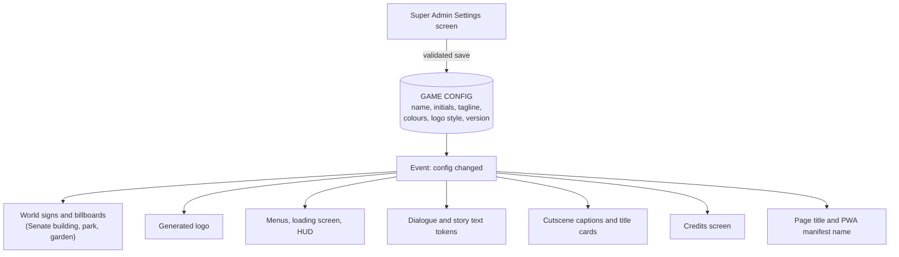

Config fields (suggested): `gameName`, `gameShortName`, `initials`, `initialsOverride`, `tagline`, `primaryColour`, `secondaryColour`, `logoStyle`, `currencyName`, `configVersion`.

## 5.3 Rules
- **No component may contain the name or initials as a literal string.** Search the whole codebase for the current name, initials, and old names, and replace each with a config lookup. The validator fails if any appear hard-coded.
- **Text tokens** are used in all story text, dialogue, UI strings, and cutscene captions: `{{GAME_NAME}}`, `{{GAME_INITIALS}}`, `{{TAGLINE}}`, `{{CURRENCY}}`, `{{PLAYER_NAME}}`. One `resolveText()` function replaces them. Never concatenate the name by hand.
- **Initials are auto-generated** from the name (first letter of each word in capitals: "Freshers School Life Game" becomes FSLG), with an optional **manual override** for names where the automatic result is wrong. Show a live preview in settings. Initials must be 1 to 6 characters.
- **Signs and logos are generated at runtime** (canvas or vector text) from the config. No image file contains the name. When the config changes, regenerate sign textures once and cache them.
- **Sign slots** are defined in the level data (`signSlots`: location, size, style, and which field it shows: full name, initials, tagline, or logo). Adding a sign is one data entry, never new code. The Senate building, park, garden, gates, and hostels all use sign slots.
- **Auto-fit:** text shrinks or wraps to fit its slot. A very long name must never overflow a sign or a menu.
- **Live update:** changing the config fires an event, and every subscriber redraws. No restart. Test this.
- **Metadata:** update `document.title`, the PWA manifest `name` and `short_name`, and the cache version when the name changes. If the manifest is static, generate it from the config at build time and document the process.
- **Validation:** non-empty name, maximum length, safe characters, initials length. Reject invalid input with a clear message.
- **Fallbacks:** if the config is missing or corrupt, load safe defaults, log an error, and keep the game playable.

## 5.4 Super admin settings

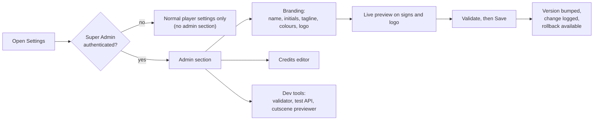

**Security rule:** a browser game cannot protect anything by hiding a button. Anything running in the player's browser can be changed by the player. Choose one approach, document it in `docs/DECISIONS.md`, and tell me which and why:
1. **Backend-authenticated (recommended for a public release).** A small server with real login. Only a logged-in super admin can write config and credits. Players only read them. The game fetches the config at start-up and caches it for offline use.
2. **Build-time config (simplest while I develop alone).** Config and credits live in JSON files that I edit and ship with each build. The admin settings screen is a dev-only tool that exports the JSON.
3. **Local-only admin (private testing only).** A passcode-protected panel that saves to local storage. **Not secure.** It must never be presented as secure or shipped to players.

Whichever is used:
- Admin code and UI are not reachable from the normal player flow.
- Never put a real password or secret in front-end code.
- Log every admin change: who, when, what, old value, new value.
- Keep **config history** with rollback to a previous version.
- The game works offline using the last known good config.

## 5.5 Make anything likely to change data-driven
Tagline, colour theme, intro text, currency name, location names, NPC names, mission names, sign text, and credits belong in data, not code. List every candidate in the Phase 0 audit.

## 5.6 Localisation readiness
All player-facing text lives in text files with IDs and tokens, never inside code. This costs little now and makes later translation (Hausa, Yoruba, Igbo, Pidgin) possible. Do not build translation features yet; just keep the text separate.

## 5.7 Definition of done for config
- [ ] Rename in settings updates signs, logo, menus, captions, credits, page title, and manifest name without restart
- [ ] Validator confirms no hard-coded names
- [ ] Very long and very short names render correctly
- [ ] Old saves still load after a rename

## 5.8 Audit questions for the AI (answer in `docs/AUDIT.md`)
1. Where does the game currently store the name, initials, signs, and logo? List every file and line.
2. Which admin approach in Section 5.4 suits the project, and what would it need?
3. How are signs currently rendered (textures, meshes, sprites), and can they become runtime-generated slots?

---

# 6. CODE-DRIVEN CUTSCENES

## 6.1 Answer and approach
**Yes, cutscenes can be made entirely in code**, and for this game it is the better choice. They run live inside the engine with the same characters, animations, camera, and sounds as gameplay, so:
- they add almost nothing to download size (a cutscene is a small data script)
- the **player's own appearance, outfit, and vehicle** appear automatically
- **friends travelling with the player** appear automatically
- they can use the current time of day, weather, location, and the dynamic game name
- they can be skipped, replayed, and previewed
- they work offline and on low-end phones

Honest limits: speech appears as text bubbles with short character "blip" sounds, because the game cannot generate anyone's voice live. Optional **recorded voice lines** can be added later as small compressed audio files with a setting to turn them off. "How the player speaks" means the player's name, outfit, and dialogue style appear. No audio of the player is recorded.

## 6.2 Architecture

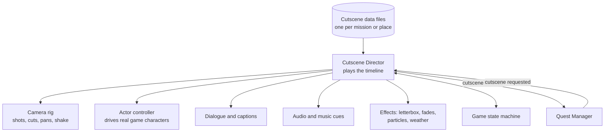

Rules:
- The **Director** plays a **timeline** from data. It never contains story content.
- Cutscenes are **data in separate files** (one per mission or place, grouped by level), loaded on demand and unloaded after. The Quest Manager and validator know which cutscene belongs to which step.
- Cutscenes use the **real game entities** (player with current outfit, present companions, NPCs, vehicles), not copies.
- Cutscenes **never change game data directly.** They emit events, and the Quest Manager decides what happens.

## 6.3 Types of cutscene

| Type | Behaviour | Examples |
|---|---|---|
| **Full** | Input locked except skip. Letterbox. Camera fully controlled. | Opening (parents drop you at school), mission intros, endings |
| **Ambient (live)** | Player keeps control. Camera stays near gameplay with small push-ins or looks. Characters talk or act around you. | A friend calls out as you walk to class, a crowd as you approach the Senate building |
| **Vehicle** | Short camera sequence tied to a vehicle action. | Getting into a car with friends, arriving at the school gate |
| **Entry** | First time the player enters a place. | First time in a lecture hall, hostel, or the dam |
| **Event** | Triggered by world events. | Rain starts, power outage, announcement |
| **Mission bookends** | Briefing before, result after. | Every major mission |
| **Finale** | The longest and most elaborate. | The end of the game, followed by credits |

## 6.4 Cutscene state machine

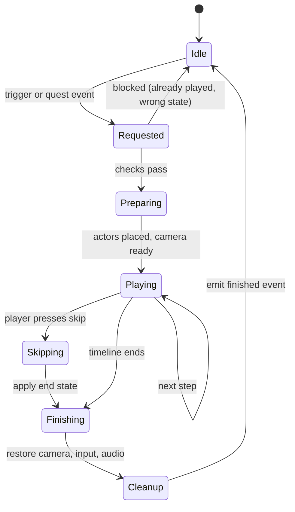

Rules:
- **Preparing** places actors (or fades through black), saves what must be restored, and loads needed assets.
- **Skipping must reach the same end state as watching.** Every cutscene declares an `endState` (positions, quest flags, items, time of day, camera, who is in the vehicle). Skip applies it instantly. This is the most common cutscene bug, so it is tested for every cutscene.
- **Cleanup always runs**, even on error: restore input, camera, HUD, audio levels, and animation states. On error, abort safely, apply the end state, log the bug, and keep the game running.
- **A cutscene can never trap the player.** A watchdog aborts any cutscene exceeding its `maxDuration`.
- Cutscenes play **once** by default, with replay from a menu once seen. "Seen" flags are saved.

## 6.5 What a cutscene script describes
- **Camera:** cut to a shot, pan, dolly, orbit, follow an actor, look at a target, shake, change field of view, return to the gameplay camera
- **Actors:** walk to a point, face a target, play an animation (from the list in Section 10), enter or exit a vehicle, sit, stand, emote, look at
- **Role-based casting:** steps refer to **roles** (`PLAYER`, `FRIEND_1`, `FRIEND_2`, `LECTURER`, `PARENT`), not fixed characters. The Director fills roles from who is present. If a role is missing, use a defined **fallback** (another NPC, or skip the line).
- **Dialogue:** speaker role, text with tokens, duration or "wait for press", mood, optional blip sound
- **Companions:** friends with the player appear in their own positions, seats, and outfits
- **Audio:** music start, stop, change; sound effects; ambience changes
- **Effects:** fades, letterbox, slow motion, flash, rain on or off, time-of-day change, particles
- **World:** open or close doors, spawn or remove props or NPCs, move vehicles
- **Flow:** wait, parallel steps, branch on a flag (for example whether the player has a car), emit an event
- **Meta:** `id`, `skippable`, `maxDuration`, `endState`, `playOnce`, `requires`, `ambient`

Keep scripts **small and readable**: adding a cutscene means writing data, not engine code.

## 6.6 Design practices
1. **Short and purposeful.** Most are 10 to 40 seconds. Only the opening, big story beats, and the finale run longer.
2. **Always skippable** (hold-to-skip or a button, with a hint after a few seconds).
3. **Show, then tell.** Prefer camera and action over long text.
4. **Clear shots:** wide establishing shot, closer shots on the speaker, back to wide. Do not cut too fast.
5. **Smooth handover:** the gameplay camera blends in and out with no jumps.
6. **Readable on a phone:** large captions, safe margins, at least about 15 characters per second reading time (adjustable).
7. **Consistent tone:** funny, warm Nigerian campus life. Keep all text in `docs/STORY_TEXT.md`.
8. **Reward the player:** unlock something, reveal a place, or advance the story.
9. **Accessibility:** captions on, text size option, and a reduced-motion option that removes shake and flashing.
10. **Never block on assets.** If something is not loaded, fade and load, or skip the shot. Never freeze.

## 6.7 Where cutscenes should appear (minimum list)
- [ ] **Opening:** parents drop the player at school, title card using `{{GAME_NAME}}`, first objective
- [ ] **Every major mission:** briefing before, result after
- [ ] **First entry to each key place:** lecture hall, hostel, admin block, Senate building, sculpture garden, dam, market
- [ ] **Vehicle moments:** getting in with friends, arriving at important places
- [ ] **Event moments:** rain starts, power outage, announcements, a surprise test
- [ ] **Ambient cutscenes** while walking (friends calling out, NPC conversations, crowds)
- [ ] **Failure and retry moments** (short, funny, never punishing)
- [ ] **The finale:** the biggest cutscene, with the whole campus and the player's friends, followed by credits

## 6.8 Performance rules
- Scripts are tiny data files, **loaded when needed and unloaded after**.
- Reuse existing models, animations, and sounds. **No video files and no large cutscene-only assets** without my approval.
- Crowds use the same LOD and instancing rules as the world.
- The frame budget still applies. Provide a **low-quality cutscene mode** (fewer extras, simpler effects) used automatically on weak devices.

## 6.9 Testing cutscenes
- [ ] Every cutscene referenced by a quest step exists, and every cutscene file is referenced
- [ ] Every role, animation, sound, location, prop, and vehicle used exists
- [ ] Every cutscene has `endState`, `maxDuration`, and `skippable`
- [ ] **Skip test:** the bot plays each cutscene fully, then loads the same state and skips it. Both must reach the **same end state**
- [ ] **Companion test:** zero, one, and several friends present. No cutscene may break
- [ ] **Outfit and vehicle test:** different outfits and vehicles, no clipping, no missing seats, no heads through roofs
- [ ] **Interruption test:** quit, pause, tab switch, or lose focus mid-cutscene. The game must recover
- [ ] **Save test:** save and load during, just before, and just after each cutscene
- [ ] **Previewer** (admin tools): choose any cutscene, time of day, weather, and companions, then play, step, or scrub the timeline
- [ ] **Text check:** captions fit small screens and tokens resolve, including after a rename

## 6.10 Cutscene workflow

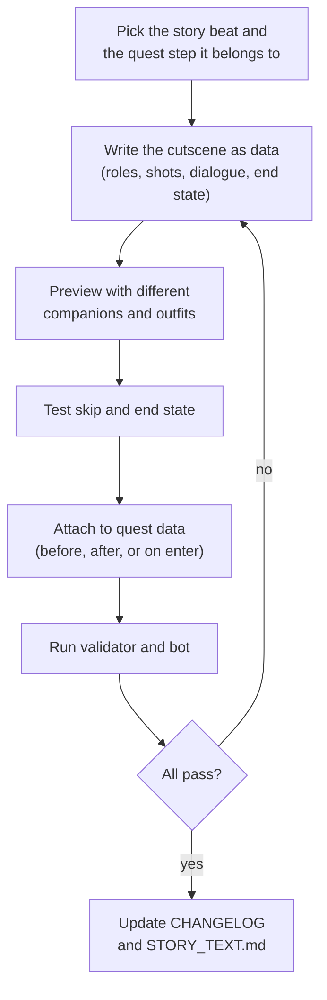

## 6.11 Audit questions for the AI
1. What intro or cutscene code exists? Reuse or replace?
2. How are outfit, vehicle, and companions represented so cutscenes can reuse them?
3. What does it take for the camera to blend smoothly between gameplay and cutscene shots?
4. Which animations are missing for the list in Section 6.7?

---

# 7. DYNAMIC CREDITS

## 7.1 Requirement
Credits are **never hard-coded**. As people help (voice acting, physics help, art, music, testing, translation), the super admin can add, edit, reorder, and remove credits from settings without changing code. The end-of-game credits build themselves from this data.

## 7.2 Data flow

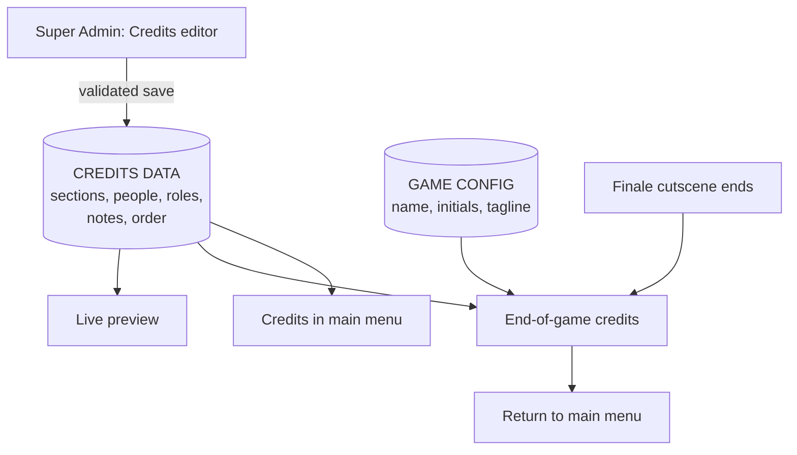

## 7.3 Rules
- **Sections** (for example Created By, Voice Cast, Physics and Engineering, Art, Music and Sound, Testing, Translation, Special Thanks), each with a title, order, and entries.
- **Entry:** `name`, `role` (free text such as "Voiced the lecturer"), optional `note`, `link`, `characterName`, `order`, `visible`, `approved`. A person can have several roles.
- **Editor:** add, edit, delete, drag to reorder, hide without deleting, duplicate, search, **live preview**, and warnings for duplicates or empty fields.
- **Runtime-generated scroll** styled to the game, using the name from config, a generated logo, and the tagline. It must handle zero credits (a short default message), a few, and hundreds without layout problems or slowdowns.
- Playable from the end of the game, from the main menu, and as an admin preview. **Skippable.** Scroll speed adapts to screen size.
- **Same storage approach, history, rollback, and change log as the config** (Section 5.4).
- **Sanitise all text.** Names are user-entered, so never render them as raw HTML.
- **Privacy and consent:** a name appears only with the person's agreement. The `approved` flag keeps entries hidden until confirmed.
- Credits data is checked by the validator (Section 4.6).

---

# 8. FEATURE WORKFLOW, DEFINITION OF DONE, BUG-FIX LOOP

## 8.1 Feature workflow (use for every new feature)

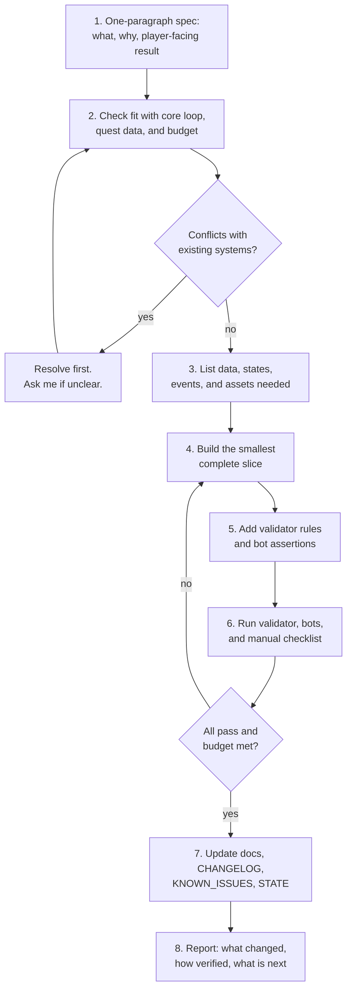

## 8.2 Definition of Done (every feature and fix)
- [ ] Works on a low-end Android phone and on desktop
- [ ] Controls work with touch, keyboard, and gamepad (if supported)
- [ ] No console errors or warnings
- [ ] Validator and bots pass
- [ ] Save and load works mid-feature
- [ ] Animation, sound, and feedback are present (Sections 10, 13, 14)
- [ ] Performance budget met (Section 9)
- [ ] Old behaviour it replaces is removed
- [ ] No hard-coded name, initials, or changeable text
- [ ] Cutscene or reason for none (for missions and new places)
- [ ] Docs updated (`STATE.md`, `CHANGELOG.md`, `KNOWN_ISSUES.md`, `STORY_TEXT.md` where relevant)
- [ ] Works on every build target it applies to (website, portal demo, offline app)
- [ ] Data access goes through the data layer, with no direct database calls
- [ ] Assets recorded in `assets/ASSET_LICENSES.md`

## 8.3 Bug-fix loop

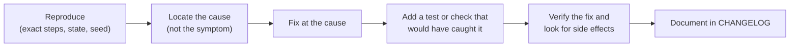

---

# 9. PERFORMANCE BUDGET AND WEB/PWA RULES

| Item | Target |
|---|---|
| First load (core pack, compressed) | About 20 to 30 MB at most, interactive in under about 8 seconds on a mid-range phone over 4G. A smaller first-load target is better |
| Total game size | Up to about 200 MB if justified by quality, delivered in streamed packs (Section 24.3) |
| Single file size | Below the hosting limit (check current Cloudflare Pages limit), otherwise use R2 |
| GPU memory | Stay within safe limits for low-end phones: compressed textures (KTX2), texture size caps per quality tier |
| Frame rate | Steady 60 FPS desktop. 30+ FPS on a low-end phone. No frozen frames |
| Frame time | Logic and render under 16 ms (desktop), under 33 ms (low-end) |
| Draw calls | As low as possible. Batch and instance repeated things |
| Memory | No steady growth across a 30-minute session |
| Garbage | No per-frame object allocation in the game loop |
| Battery and heat | No sustained maximum CPU or GPU load on phones. Offer a battery saver mode |

Rules:
- **Fixed timestep** for logic (for example 60 Hz) with interpolated rendering.
- **Object pools** for particles, ripples, rain, birds, projectiles, and sounds.
- **Instancing** for trees, crowds, birds, statues, and props.
- **Culling** of everything off-screen. **LOD** for far characters (fewer limbs, no small-part animation).
- **Chunked world streaming.** Load interiors and distant areas on demand and unload after leaving. Fade or place pop-in beyond view range.
- **Texture atlases** and procedurally generated shapes where possible. Compress audio (Opus or OGG) and use sound sprites.
- **Blob shadows** for NPCs. Real shadows only for the player, if at all.
- **Graphics quality setting** (low, medium, high) scaling particle counts, draw distance, crowd size, and cutscene extras. Detect weak devices and default to low.
- **Pause everything when the tab is hidden** (rendering, audio, timers).
- **Resize and orientation:** handle window resize, phone rotation, and different pixel densities. Cap the render resolution on high-density screens.
- **Storage:** respect browser storage limits. Keep saves small, and handle quota errors and private browsing.
- **PWA:** manifest, service worker with asset caching and versioned cache names, offline play, an update prompt, and a safe path when an update changes the save format. Optional wrappers later (Capacitor for mobile, Tauri for desktop).
- **Profiling:** a debug overlay (FPS, frame time, draw calls, entity counts, memory). Check it after every feature.
- **Asset licensing:** every font, sound, music track, and image must have a recorded licence or source in `docs/DECISIONS.md` or an assets list. No unlicensed assets.

## 9.1 Revised size plan (version 2)
- The earlier 5 MB first-load target is replaced by the table above, because the game is moving to a richer engine and streamed packs.
- **Memory matters more than download size.** Uncompressed textures can use many times their file size in graphics memory. Use KTX2 and per-tier texture caps.
- Every pack has a size budget in config, and the build fails if exceeded.
- Show pack sizes to players, and offer Wi-Fi only downloads (Section 24.3).

---

# 10. ANIMATION STANDARDS

## 10.1 Principles (the ones that matter for a light, blocky character)
1. **Anticipation:** a small wind-up before big actions (crouch before a jump, pull-back before a punch).
2. **Follow-through and overlap:** parts settle after the main motion (arms, head, clothes lag slightly).
3. **Squash and stretch:** very small scale changes on landing and jumping.
4. **Ease in and out:** no linear motion for body parts.
5. **Arcs:** limbs and head move in curves.
6. **Timing:** quick actions feel light, slow ones feel heavy. Tune by feel.
7. **Exaggeration:** push poses slightly further than real life so they read at small size.
8. **Secondary action:** blinking, breathing, a head turn toward interesting things.
9. **Readability:** every action reads from its silhouette.

## 10.2 Technical rules
- **Procedural first.** Sine-based walk and run cycles and spring-based secondary motion instead of heavy keyframe data.
- **Match speed to movement:** the cycle speed follows actual ground speed so feet never slide.
- **Blend, never snap.** Blend between states in 100 to 200 ms (shorter in combat). Higher-priority animations interrupt lower ones (Hit beats Walk).
- **Layering:** locomotion on legs and torso, upper-body actions (punch, wave, hold phone) layered on top.
- **One owner per body part per frame.** Resolve conflicts with priorities, never by overwriting.
- **Animation events:** footstep sounds, hit frames, and door-open frames fire from named events in the animation, not from separate timers.
- **Hit-stop** (about 50 to 80 ms freeze) plus a small camera shake for hits and punches.
- **Root motion vs in-place:** choose one per animation and document it.
- **Cutscene compatibility:** every animation can be triggered by a cutscene step and can be forced to its end pose (needed for skip).

## 10.3 Animation checklist
Each needs a start, a body or loop, an end, a sound, and a test.
- [ ] Idle (breathing, looking around, impatient shift after a while)
- [ ] Walk, run, sprint, stop (slight skid), turn in place
- [ ] Jump, fall, land (soft and hard)
- [ ] Stumble, fall down, lie, get up
- [ ] Sit down, sit idle, stand up (chairs, benches, lecture seats)
- [ ] Punch, get hit (light and heavy), knock-back, recover
- [ ] Enter car, drive, exit car (every seat, both sides)
- [ ] Bicycle: mount, pedal (legs linked to the wheel), steer, dismount
- [ ] Enter and exit building (door animation, transition, sound)
- [ ] Friends: follow, wait, enter and exit your vehicle, sit in their seats
- [ ] Swim (surface), dive, surface, breath gasp, drown
- [ ] Emotes and reactions (laugh, wave, shock, tired)
- [ ] NPC idle, walk, talk gestures

---

# 11. PHYSICS AND COLLISION CHECKS

## 11.1 Clothing and limbs (feet and legs clipping when running)
- Clothes are **separate layers slightly larger than the body** (about 1.05 to 1.1 times) so limbs never poke through.
- Limit joint ranges (for example leg swing about 35 degrees walking and 50 degrees running) so limbs cannot rotate through clothing.
- Trousers, skirts, and long clothing follow the legs with **spring-lag** and are clamped so feet never show through the hem.
- Draw order and depth are consistent: body, clothing, shoes, accessories. Test every outfit with every animation.
- Add a debug mode that colours body and clothing separately to spot clipping.

## 11.2 Vehicles
- Every vehicle defines: **seat anchors** (position, rotation, pose), **door anchors**, **roof height**, **interior mesh**, and **wheel radius**.
- **Head clearance rule:** seat height + seated torso + head must be less than roof height. The validator fails if not.
- The interior is drawn: a dark interior box, seats, dashboard, and steering wheel. **No invisible or empty seat areas.**
- Draw order: body, interior and seats, player, windscreen and frame on top.
- **Wheels:** rotation = distance travelled divided by wheel radius. Front wheels also turn with steering.
- **Steering wheel** rotates with steering input (about 90 degrees each way), and the driver's hands follow it.
- **Horn:** a sound that plays while held, with a small reaction from nearby NPCs and birds.
- Passengers use the same anchor system. The player cannot enter a full seat.
- While seated, the player collider is off and the vehicle collider is used.
- Bicycles: spinning wheels, pedal-linked legs, steering that moves the handlebars.

## 11.3 World collision
- Use simple shapes (boxes, circles) for collision, never the render mesh.
- A spatial grid or similar broad-phase so collision cost does not grow with world size.
- **No falling through the ground:** clamp to terrain height, and teleport to the last safe position if the player goes below the world.
- **No getting stuck:** if movement input is held but position has not changed for 1 to 2 seconds, nudge the player out along the collision normal.
- Doors, stairs, and ramps have explicit trigger zones and step-height rules.

## 11.4 Water
- Entering water triggers a splash (particles, ripple, sound) from a pool.
- Swimming has its own speed, buoyancy, and animation states.
- **Breath meter:** drains underwater at a set rate (for example 20 to 30 seconds), refills at the surface, and warns visually and by sound when low.
- Friends swim with you using the same follow logic as on land.
- Underwater: fog, tint, bubbles, and muffled audio. No expensive volumetric effects.

---

# 12. ENVIRONMENT STANDARDS

## 12.1 What a good environment needs
- **Sky:** day and night cycle, moving clouds, sun and moon, and a few birds (instanced or simple boids).
- **Weather:** rain with splash particles, wet ground, a darker sky, changed ambient audio, and puddles. Optional harmattan haze and dust.
- **Life:** students walking between buildings, hawkers, bikes and tricycles, generators, queues and crowds, with busy and quiet times of day.
- **Ambience:** wind in trees, birds, distant crowd, music from shops or hostels, and rooms that sound different inside.
- **Surfaces:** footstep sounds and dust by surface (tile, grass, sand, wet).
- **Landmarks and wayfinding:** each area is distinct and recognisable from afar. Use light, colour, and signage (generated from config) to guide the player. Do not rely on the arrow alone.
- **Points of interest:** something worth seeing every 30 to 60 seconds of walking.
- **Small details:** flags, posters, hanging clothes, stray animals, and scattered objects that make places feel lived in.

## 12.2 Sculpture garden
- Statues of people, animals, and frogs in a readable layout with paths and benches.
- Simple blocky models, instanced where repeated.
- Small interactions: a frog hops when you approach, a plaque with a funny line, a photo spot.
- A calm audio mood (birds, water, soft music).
- Signs use sign slots (Section 5.3).

## 12.3 Dam and swimming area
- Rules in Section 11.4.
- A diving spot, a shallow area, a deeper area with warnings, and a shoreline with props.
- Ripples from entries, character movement, and rain. Draw ripples as pooled sprites over a simple scrolling-texture water surface.

## 12.4 Environment checklist
- [ ] Day, night, and weather transitions are smooth and cheap
- [ ] Birds, clouds, and rain use pooled or instanced implementations
- [ ] Every area has a unique silhouette, colour, and sound
- [ ] NPC and vehicle counts scale with the quality setting
- [ ] Nothing visibly pops in or out
- [ ] Signs show the current name and initials from config

---

# 13. GAME DESIGN PRACTICES

## 13.1 Core loop and player experience
- Define the **core loop** in one sentence (for example: take a goal, travel across campus, interact, get rewarded, unlock the next goal). Every feature must serve it.
- **A clear goal at all times.** The player can answer "what am I supposed to do?" in 3 seconds. Objective HUD, guide, and map always agree.
- **Teach by doing.** Introduce one mechanic at a time in a safe place, then combine.
- **Feedback for every action** within 100 ms: animation, sound, particles, and a UI response.
- **Fairness:** no unexplained failures. Show the cause.
- **Short sessions:** playable and saveable in 5-minute chunks, because many players are on phones.
- **Checkpoints and autosave** at every quest step and area change.

## 13.2 Story and quest design
- Every step has a **goal, location, trigger, reward or consequence, and text for guide, map, and dialogue** from the same data.
- Clear **order and dependencies** (`requires`, `next`), tested by the validator.
- Optional side activities never break or block the main story.
- Consistent tone: funny, relatable Nigerian campus life (sapa, hostel wahala, registration queues, lecture rush).
- All text lives in `docs/STORY_TEXT.md` and the text data files so consistency can be reviewed in one place.
- Cultural care: keep humour affectionate and avoid stereotypes that mock groups of people. Review sensitive jokes before they ship.

## 13.3 Open world design
- **Districts around a hub:** hostels, lecture halls, admin, market, sculpture garden, dam.
- **Travel must be fun:** vehicles, shortcuts, and things to see. No long empty stretches.
- **Fast travel** or quick vehicle summon once the world is learned.
- **Soft guidance:** arrow, map, landmarks, NPC hints. No hard walls without a reason.
- Mini-map and full map always match the current objective and known places.

## 13.4 UI and controls
- Mobile-first: large touch targets, joystick and buttons, readable text.
- Keyboard and gamepad support. Rebindable keys if possible.
- **Contextual prompts** ("Press E to enter car") appear only when relevant.
- Consistent HUD: objective, health or energy, breath (when swimming), and money (the sapa meter).
- Settings: volume, quality, controls, text size, reduced motion, captions, and (later) language.
- **Accessibility basics:** adequate contrast, text scaling, no information conveyed by colour alone, and no flashing effects beyond safe limits.

## 13.5 Systems that fit the theme (add only after the core is stable)
- Sapa meter (money and energy pressure), food, transport costs, small jobs.
- Grades, lectures, and attendance as quests and consequences.
- Friends and relationships with simple rules (follow, hang out, help).
- Random campus events (rain, power outage, protest, surprise test).
- Collectibles and achievements with a funny voice.

---

# 14. AUDIO AND VOICES

- Every action has a sound: footsteps by surface, hit, punch, door, car, horn, splash.
- Mix: music lower than effects, with ducking during dialogue and cutscenes.
- Audio is loaded lazily, pooled, and capped (maximum simultaneous sounds).
- Browsers unlock audio only after the first user input. Handle this explicitly with a clear first-tap prompt.
- Character "blip" sounds for dialogue, pitch-shifted per character.
- Optional recorded voice lines later: small compressed files, off-switch in settings, and credited in the credits data.
- Respect the device mute switch and the tab visibility (pause audio when hidden).
- **Voice pipeline:** see Appendix C. Generated voices are placeholders, recorded voices need written permission and a credits entry, and every voice file's model and licence is logged.
- Dialogue audio files are named from dialogue IDs so a line can be replaced without touching code.

---

# 15. TESTING

## 15.1 Layers
1. **Validator** (Section 4.6): data consistency, run on every dev load and in CI.
2. **Debug API** (`window.__test`, dev only): `teleportTo(zone)`, `getState()`, `getObjective()`, `press(key)`, `advanceDialogue()`, `setTime(t)`, `setWeather(w)`, `spawnVehicle(id)`, `playCutscene(id)`, `skipCutscene()`, `setConfig(patch)`, `setSeed(n)`.
3. **Scripted bot:** plays level 1 in order. After every step it asserts that objective text, guide arrow, map marker, and `currentStepId` all agree, and that the step advances within a time limit. It also plays every cutscene and tests skip.
4. **Monkey bot:** random inputs for several minutes with a logged seed. Reports crashes, soft-locks (no progress for N seconds), falling through the world, and stuck states.
5. **Save and load test:** save at every step and around every cutscene, reload, and confirm the game continues correctly. Also test an **old-version save**.
6. **Rename test:** change the config name and initials mid-game and confirm every sign, menu, caption, and credit updates.
7. **Visual checks:** screenshot comparison for key poses (seated in each car, running in each outfit, swimming, signs with long and short names).
8. **Performance test:** a 10-minute session recording FPS, frame time, and memory against the budget.
9. **Manual checklist** for feel: animation quality, audio, readability on a phone.
10. **Browser Playwright (or similar) runner** to open the game, run the bots, collect console errors, screenshots, and video, and write a JSON and markdown report with one command.

## 15.2 Test flow

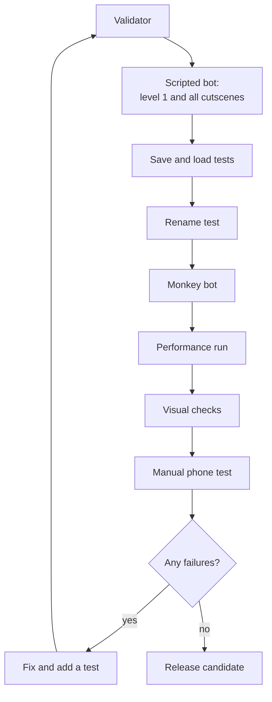

## 15.3 Bug report format (bots and humans)
- **ID, severity** (blocker, major, minor), **area**
- **Steps to reproduce**, **seed**, and **game state dump** (step ID, position, player state, time, weather, config version)
- **Expected vs actual**
- **Screenshot or short video**
- **Console errors**
- **Suspected cause** (if known)

## 15.4 AI playtesting
A vision-capable AI model driving the browser can be used later for a "does this make sense to a new player" pass (for example when guide arrow and map seem to point different ways). It is slower, costs more, and is less repeatable than scripted bots, so use it as a final review only. The scripted bot, monkey bot, and validator come first.

## 15.5 Additional tests (version 2)
- **Parity tests:** the extracted project matches the Django version (row counts, sample records, admin capabilities, level-1 playthrough).
- **Data layer tests:** every repository passes the same test suite on SQLite and on the hosted database in a staging project.
- **Build target tests:** the website, portal demo, and offline builds each start, reach their intended end, and respect their size budgets. The demo gate cannot be bypassed.
- **Pack tests:** a missing, corrupt, or evicted pack is detected and re-downloaded. The game never enters an area without its pack. Offline play works after caching.
- **Event tests:** events start and end on time, kill switches work, and the game runs with all flags at defaults and no network.
- **Renderer interface tests:** the same scenes render through each engine adapter. Screenshots are compared for key views.
- **Real-device checks:** at least one low-end Android phone, one mid-range phone, and one desktop browser, recording FPS and memory.

---

# 16. WORKING PROTOCOL (HOW THE AI MUST REPLY)

## 16.1 Reply structure for every task
1. **Understanding:** what you think the task is, in 2 to 3 lines. Ask only if something truly blocks you.
2. **Findings:** what is wrong or missing now, with file and line references.
3. **Plan:** the exact files you will change, in order.
4. **Changes:** the complete changed files (Section 1.3 rule 5).
5. **Verification:** which validator rules, bot checks, and manual checks you ran or added, and the results. Say plainly what you could not run.
6. **Risks and follow-ups:** anything left, and anything you were unsure about.
7. **Doc updates:** what you changed in `STATE.md`, `CHANGELOG.md`, and `KNOWN_ISSUES.md`.

## 16.2 Never do
- Keep two versions of the same system "just in case."
- Hard-code a destination, ID, name, initials, or text that exists in data.
- Skip the validator or the budget check.
- Add a feature that does not serve the core loop without asking me.
- Leave a TODO that is not in `KNOWN_ISSUES.md`.
- Claim something is fixed without saying how it was verified.
- Truncate a file or replace code with a comment like "rest of file unchanged."
- Change the save format without a version bump and a migration.

---

# 17. SCOPE CONTROL AND RISK REGISTER

## 17.1 Priorities (MoSCoW)
| Priority | Items |
|---|---|
| **Must** | Audit, Django inventory and safe extraction, consolidation, single source of truth, dynamic config, flow fix, versioned saves, validator, scripted bot, engine bake-off and decision, car seat and clipping fixes |
| **Should** | Cutscene Director with opening and mission cutscenes, credits system, animation checklist, performance budget, PWA, platform layer and portal demo, pack streaming, admin dashboard, event calendar |
| **Could** | Sculpture garden, dam and swimming, rain and birds, ambient cutscenes, recorded voice lines, finale polish, in-game devlog voting, photo and clip mode |
| **Later** | Translation, extra theme systems (sapa meter depth, grades), community mission creator tools, rewarded videos, payments and shop, more games on the platform, gamepad rebinding |

## 17.2 Scope rules
- Build a **vertical slice** first: one mission, from opening cutscene to mission end, fully correct and within budget, before widening.
- A new idea goes to `docs/DECISIONS.md` as "proposed" with a size estimate (small, medium, large) and what it would displace.
- Do not start a "Could" item while a "Must" or "Should" item is open without my approval.

## 17.3 Risks
| Risk | Why it matters | Mitigation |
|---|---|---|
| Old and new level-1 code keep mixing | Causes the stuck and wrong-destination bugs | Phase 0 audit, tagged backup, delete dead code, loud failures on old IDs |
| Hard-coded name or text creeps back | Breaks the dynamic name and consistency | Validator rule, token system, review in every task |
| Skip leaves the game in the wrong state | Soft-locks and broken story | `endState` required, skip test on every cutscene |
| Performance drifts down over time | Game becomes unplayable on cheap phones | Budget, overlay, 10-minute performance runs, quality settings |
| Admin tools exposed to players | Anyone could change branding and credits | Section 5.4 approach, no secrets in front-end code, logged changes |
| AI loses context between sessions | Drift and duplicated work | `STATE.md`, session protocol, `DECISIONS.md` |
| Save format changes break progress | Players lose progress | Save versions and migrations, old-save test |
| Scope growth (months of development) | Project never reaches a playable release | MoSCoW, vertical slice, scope rules |
| Unlicensed assets or credits without consent | Legal and trust problems | Asset list with licences, `approved` flag on credits |

## 17.4 Additional risks (version 2)
| Risk | Why it matters | Mitigation |
|---|---|---|
| Extraction damages or changes the Django project | Loses the backup and working version | Read-only rule, work from a copy, no destructive commands, tagged backups |
| Secrets or personal data copied by mistake | Security and privacy harm | Rule 14, `.env.example`, anonymised test data, review before commit |
| Engine migration drags on or breaks the game | Months of work lost | Renderer interface, old renderer kept until approval, one system at a time, bake-off first |
| Realistic graphics break phones | Players cannot play | Quality tiers, KTX2, texture caps, budget wins over realism, real-device testing |
| Fabricated or flattering comparisons | Poor decisions | Rule 15: real screenshots and measurements only |
| Free-tier limits or rules change | Sudden outage or cost | Verify at launch, record dates, keep backups and a simple migration path |
| Portal rules conflict with the plan (links, SDK, size, exclusivity) | Rejection or lost audience | `docs/PORTALS.md`, adapters per target, read terms before building each target |
| Free database pauses or changes terms | Data unavailable or lost | Offline-first, scheduled backups, keep-alive that makes real requests, repository swap path |
| Admin tools reachable by players | Anyone could change branding and data | Access rules enforced in the database and server, audit log, rollback |
| Scope explosion from the platform vision (many games, events, missions) | The first game never ships | Phases, MoSCoW, vertical slice, creator tools deferred, one game first |

---

# 18. EXTRACTING THE GAME FROM DJANGO (COPY, NEVER DELETE)

## 18.1 The rule
The game currently lives inside a Django project. You will create a **new, separate, standalone TypeScript project** containing everything the game needs. **Do not delete, move, rename, or modify anything in the Django project.** The Django project stays as a working backup that I can keep, edit, or ignore. Work from a copy or in read-only mode, and never run destructive commands (migrations, deletes, resets) against the Django project or its database.

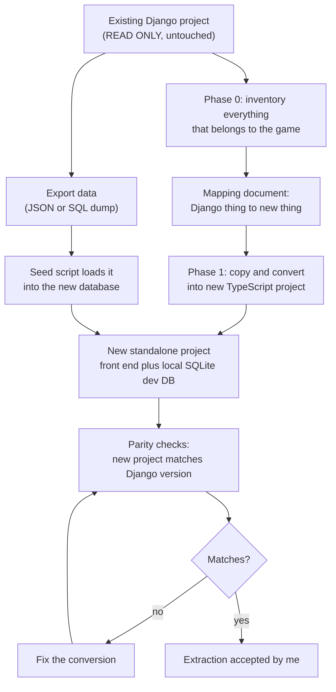

## 18.2 Django inventory (Phase 0 deliverable: `docs/DJANGO_INVENTORY.md`)
List, with file paths, everything that belongs to the game:
- **Models** (fields, types, relations, defaults, constraints, choices)
- **Views and URLs** (every route the game or its admin uses, and what each does)
- **Templates and static files** (HTML, JS, CSS, images, audio, fonts, 3D models, textures)
- **Django admin panels** (every `ModelAdmin`, list display, filters, search, inline editors, actions, permissions)
- **Settings** (game-related settings, feature flags, constants, branding, and anything in `settings.py` or environment variables that changes the game)
- **Forms, serializers, validators, signals, and management commands**
- **Authentication and permissions** (roles, super admin, groups, permission checks)
- **Fixtures, seed data, and existing database contents** (counts of rows per table)
- **Third-party packages** the game uses and what each is for
- **Anything unclear**, listed as a question for me

**Secrets and personal data (strict):**
- Never copy `SECRET_KEY`, passwords, API keys, tokens, or `.env` contents into the new project or into any document. Use placeholder names and an `.env.example` file.
- Do not copy real users' personal data unless I explicitly approve. If user records are needed for testing, use anonymised or fake data.
- **Django password hashes do not carry over** to Supabase Auth or a new login system. Plan for new sign-up or a password reset flow, and tell me.

## 18.3 Mapping document
Before copying, produce a table that maps each Django item to its replacement:

| Django item | New project replacement |
|---|---|
| Model | TypeScript type + database table + data-layer repository |
| Django admin panel | Admin dashboard page (Section 25) with the same fields, filters, search, and actions |
| Settings and flags | Config object and remote config (Sections 5 and 23) |
| View that returns data | Data-layer function (and a small local API in dev mode) |
| Template for the game page | Play page in the website (Section 24) |
| Static and media files | Asset packs (Section 24) |
| Permissions and roles | Roles in the new auth layer (super admin, editor, player) |
| Management command | Script in `/scripts` |

## 18.4 Copy and convert (Phase 1)
- Create the new project in a **separate folder**, with its own git repository.
- Convert models to TypeScript types and database migrations (Section 21).
- Rebuild each Django admin panel as part of the admin dashboard, **with feature parity first** (same fields, filters, search, and actions), then improvements.
- Move game settings into the config system, and game data into the database through seed scripts.
- Copy game assets into the new asset folders and record every file's origin and licence (Appendix C).
- Keep a **parity checklist** in `docs/EXTRACTION_PARITY.md`: each Django feature with its status (copied, improved, deferred, dropped) and the reason.
- Additions I want: more admin features, better settings screens, and live preview. These come **after** parity is confirmed.

## 18.5 Parity checks (must pass before Phase 1 is accepted)
- Row counts and sample records match between the Django database export and the new database
- Every Django admin capability has an equivalent in the new admin dashboard, or is listed as deliberately dropped
- The game plays through level 1 in the new project the same way it does in Django (scripted bot)
- Game settings produce the same behaviour
- The new project runs from a clean machine using only `docs/RUN_GUIDE.md`

---

# 19. TECH STACK AND REPOSITORY LAYOUT

## 19.1 Stack
| Layer | Choice | Notes |
|---|---|---|
| Language | **TypeScript** | Strict mode. Catches many bugs before the game runs |
| Build tool | **Vite** | Fast dev server and production builds |
| Game engine | **PlayCanvas engine or Babylon.js** | Decided in Phase 4 (Section 20) |
| Physics | Engine's own, or **Rapier** (WebAssembly) | Chosen in Phase 4 |
| Website (public pages) | **Astro** | Ships little JavaScript. Fast home, news, devlog, credits pages |
| Website (interactive) | **React + TypeScript** islands | Login, admin dashboard, settings, leaderboard |
| Menus inside the game | Engine UI or a small library (Preact or Svelte) | Never put the game loop inside React |
| Dev database | **SQLite** | Local file, behind the data layer (Section 21) |
| Production database and login | **Supabase** (or another) | Chosen later, behind the same data layer |
| Hosting | **Cloudflare Pages** (+ R2 for large files if needed) | Section 24 |
| Testing | Vitest for logic, **Playwright** for browser and bots | Section 15 |
| Models and textures | **glTF/GLB**, **KTX2** textures, **Meshopt or Draco** compression | Section 20 |

**Rule:** the game is **front-end only**. No Django, no server-side game logic. A small local dev API is allowed (Section 21), but production must work with static hosting plus the chosen database service.

## 19.2 Repository layout (monorepo, many games later)
```
/apps
  /web               (Astro site with React islands: home, play page, account, admin, devlog)
  /game-fsl          (this game: TypeScript, engine code, game data)
  /dev-api           (tiny local server with SQLite, development only)
/packages
  /engine-core       (loop, events, state machine, input, save system, validator)
  /engine-adapter    (renderer interface and the chosen engine's implementation)
  /platform          (build target adapters: website, portal, offline)
  /config            (config, tokens, remote config client)
  /data              (repository interfaces, SQLite and Supabase implementations)
  /ui-kit            (shared components and styles)
  /tools             (validator, bots, pack builder, screenshot tools)
/content
  /fsl
    /levels  /cutscenes  /text  /credits-default  /events-default
/assets
  /fsl
    /models  /textures  /audio  /fonts
/docs
/tests
/scripts
```

- One engine package and one shared library, with **each game in its own folder**, so new games reuse everything.
- All code is TypeScript with strict settings. Linting and formatting are automatic.
- **No game may import another game's code.** Shared things live in `/packages`.

---

# 20. ENGINE DECISION, MIGRATION, AND GRAPHICS COMPARISON

## 20.1 Why an engine, and what stays yours
An engine provides the hard, generic parts: rendering, PBR materials, lighting, shadows, glTF loading, skeletal animation and blending, culling and instancing, physics integration, audio, input, and an inspector. You still write: quests, cutscenes, config, credits, characters, platform logic, and everything specific to the story. **The game's data and rules must stay engine-independent.** The engine sits behind a **renderer interface** so it can be swapped later.

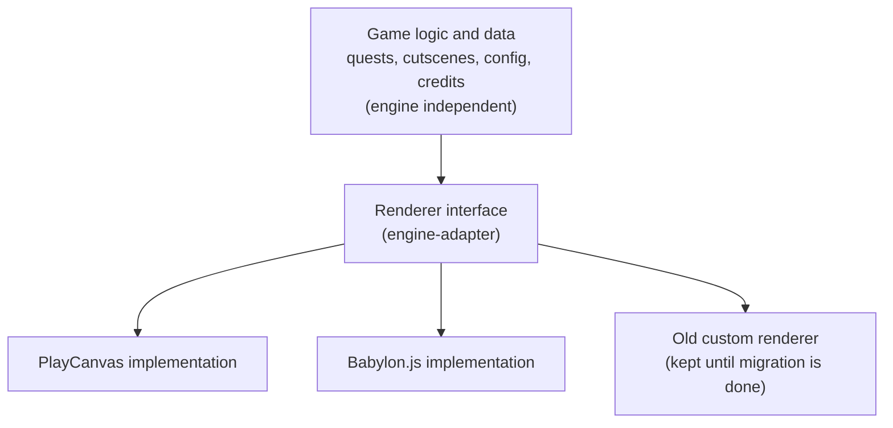

## 20.2 Bake-off (Phase 4)
Prototype **the same scene** in both PlayCanvas and Babylon.js: the player with a real outfit, running and sitting; a car with seats, working wheels, steering, and horn; and the sculpture garden with statues and frogs, birds, and rain. Use the same assets, the same camera, and the same lighting goals.

Measure and report for each engine:
- Bundle size (initial JavaScript) and total scene size
- Load time on desktop and on a low-end or mid-range phone
- Frame rate, frame time, memory, and draw calls
- Quality of lighting, shadows, materials, and animation blending
- How easily it handled: skeleton animation retargeting, clothing layers, seats and anchors, water, particles, and physics
- Developer experience: documentation, TypeScript support, errors, and tooling
- WebGPU and WebGL2 support and the fallback behaviour
- Licence and cost (the engine, any editor, and any plugins)

Output: `docs/ENGINE_DECISION.md` with a clear recommendation, risks, and what would make us switch. **I make the final decision.** Do not start the migration before I do.

## 20.3 Before and after screenshots (graphics comparison)
- In Phase 0, capture **"before" screenshots** of the current game at fixed camera positions: the school gate, a lecture hall exterior, a hostel, a character close-up, a character running, a car with a seated player, the sculpture garden (or the nearest equivalent), the dam, rain, and night. Save them in `docs/graphics/before/` with the exact position, time of day, and settings in each filename or a manifest.
- In Phase 4, render the **same views** in each engine prototype and save them in `docs/graphics/after-playcanvas/` and `docs/graphics/after-babylon/`.
- Produce `docs/GRAPHICS_COMPARISON.md` with side-by-side images and a short, honest assessment per view: what improved, what did not, and what each improvement costs in file size and frame time.
- Screenshots are taken with Playwright or an equivalent headless browser. **If screenshots cannot be captured in the working environment, say so plainly and give me the exact steps to capture them myself. Never invent or mock screenshots.**

## 20.4 Capabilities and limits report (`docs/ENGINE_CAPABILITIES.md`)
For the chosen engine and for the target devices, state plainly:
- **What we can achieve:** realistic lighting and materials, richer characters, better animation blending, more life in the environment, larger worlds through streaming.
- **What is hard or limited:** memory on cheap phones (compressed textures are essential), the cost of real-time shadows and reflections, crowd size, physics complexity, long load times on slow networks, and browser storage limits.
- **Character improvement:** what extra life is possible (facial expressions, eye and head tracking, clothing movement, emotes, foot placement on ground, better walking and running cycles), with a cost for each.
- **The honest gap:** how far the result can move from the current look, per quality tier (low, medium, high), and what would only be possible on high-end devices.
- A list of **further improvements** ranked by impact versus cost.

## 20.5 Migration (Phase 5)
- Move the game behind the renderer interface first, **with the old renderer still working**, then switch.
- Port one system at a time (characters, vehicles, world, UI, audio), each verified by the validator and bots.
- Keep game logic untouched while changing rendering. If logic must change, record why.
- Delete the old renderer only after I approve, and tag a backup first.

## 20.6 Graphics quality targets
- **Three quality tiers:** low (cheap phones), medium, and high. Quality settings control texture size, shadow quality, crowd size, particle counts, post-processing, and draw distance.
- Detect weak devices and default to low. Let players change it.
- **PBR materials** with baked lighting and lightmaps where possible, an HDR sky for ambient light, and real-time shadows only where cheap.
- Characters keep a consistent art direction with the environment. Mixing styles is a bug.
- Realistic goals must never break the performance budget (Section 9). When they conflict, the budget wins, and I decide any exception.

## 20.7 Assets: sourcing, licensing, and pipeline
- Prefer licences that allow commercial use (for example CC0 where possible). Record **source, author, licence, and URL** for every asset in `assets/ASSET_LICENSES.md`. No unrecorded assets.
- Convert models to **GLB**, textures to **KTX2**, and compress geometry with **Meshopt or Draco**. Keep source files out of the shipped build.
- Animations: reuse an existing animation library where licences allow, and retarget onto the game's skeleton. Record the licence.
- Appendix C lists categories of sources to check. Licences change, so verify each at the time of use.

---

# 21. DATA LAYER: SQLITE NOW, SUPABASE OR OTHER LATER

## 21.1 The honest constraints
- Browsers cannot use a native SQLite file directly. For a **front-end only** project, SQLite can run in the browser as **WebAssembly** (for example sql.js or wa-sqlite), stored in the browser's own storage. That data belongs to one player on one device.
- Shared data (events, credits, config, leaderboards, mission submissions) cannot live only in one player's browser. It needs a **server or a hosted database**.
- Therefore: **in development**, run a **tiny local dev API** (Node) that reads and writes a real SQLite file, so the admin dashboard and game both see the same data with one command. **In production**, replace it with Supabase or another hosted database. The game and website must not know the difference.

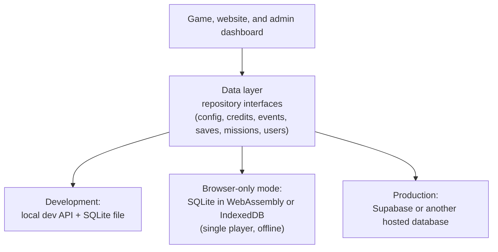

## 21.2 Rules
- **Repository pattern:** all data access goes through typed interfaces such as `ConfigRepository`, `CreditsRepository`, `EventsRepository`, `SaveRepository`, `MissionRepository`, and `UserRepository`. No component runs SQL or calls the database directly.
- **Portable SQL:** write schemas and queries so they work on both SQLite and Postgres (which Supabase uses). Avoid database-specific features unless isolated behind the repository. Use a migration tool that supports both (for example Drizzle or Kysely), and keep the schema in migration files.
- **Seeding:** a `seed` script loads the data exported from Django (Section 18) and default content. It can be run again safely.
- **Migrations:** every schema change is a numbered migration with an up and down step. Never edit the database by hand.
- **Offline-first:** saves go to the browser first, and sync to the hosted database only if the player has an account and a connection. Handle conflicts (newest wins, or ask) and test them.
- **Access control:** when moving to Supabase, use **row-level security** so players read only what they should, and only the admin role can write config, credits, events, and approvals. Never ship secret keys in front-end code.
- **Auth:** the dev API can use a simple dev login. Production uses real authentication. Both sit behind a `AuthRepository`.
- **Backups:** scripts to export the whole database to JSON, with a schedule for production. A database pause or provider change must never cost data.
- **Keep-alive (if a free tier pauses inactive projects):** a scheduled job makes a real database request every few days. Verify the provider's current rules, because what counts as activity can change.
- **Data tests:** repository tests run against SQLite in CI and against the hosted database in a staging project before production use.

## 21.3 Local development experience
- One command (`npm run dev`) starts the website, the game, and the dev API with a seeded SQLite database.
- Another resets and reseeds the database (`npm run db:reset`) for development only. It must refuse to run against production.
- Document everything in `docs/RUN_GUIDE.md` (Appendix D).

---

# 22. PLATFORM LAYER AND PORTAL EDITION

## 22.1 The idea
The game never asks "where am I running?" It talks only to small interfaces, and each **build target** supplies its own implementation. One codebase can then produce the full website game, a portal demo, and an offline app.

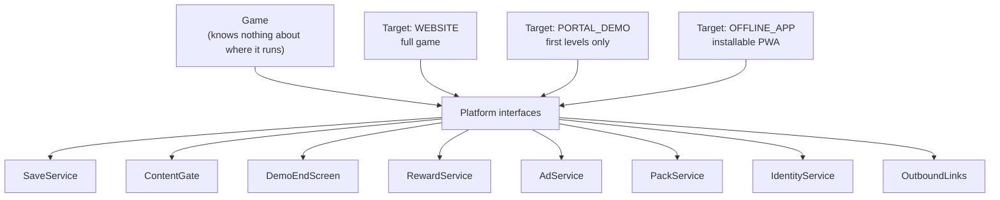

| Interface | Website | Portal demo | Offline app |
|---|---|---|---|
| **SaveService** | Cloud + browser | Browser only | Browser |
| **ContentGate** | Everything unlocked | First levels only (about the first 20 percent) | Everything unlocked |
| **DemoEndScreen** | None | "Continue the full game" message (see 22.3) | None |
| **RewardService / AdService** | Off (no ads for now) | Off, or the portal's required SDK if the portal demands it | Off |
| **PackService** | Streaming packs | Small pack list within portal size limits | Full download |
| **IdentityService** | Account login | Anonymous | Optional |
| **OutboundLinks** | Allowed | Only if the portal allows | Allowed |

## 22.2 Rules
- **One setting**, `BUILD_TARGET`, selects the adapter set at build time. The game never contains `if (portal)` checks outside the adapters.
- Adding a new portal means writing **one small adapter** and a build config, not changing the game.
- Locked content is data (`requiresTarget` or `lockedIn` on levels and items), not hard-coded checks.
- Each target has a **size budget** and a **pack list** defined in config. The build fails if a target exceeds its budget.
- All branding, links, and the demo-end message come from config, never from code.
- The validator checks every build target: gates reference real content, the demo is playable from start to the end screen, and no locked item can be reached by a bug.

## 22.3 Portal demo rules
- Read each portal's **current developer terms** before building its target: size limits, whether it requires its own SDK or ads, whether outbound links are allowed, and whether exclusivity is required. Record the findings in `docs/PORTALS.md` with the date checked. Rules differ and change.
- If links are allowed, the demo-end screen can point to the Discord page where players can ask for the full game. If links are not allowed, show only the game's name and credits so players can find it by search.
- The demo must be **polished and complete as an experience**: a real beginning, a satisfying end, and no broken or half-locked features.
- Keep the game ad-free on every target for now (Section 26).

---

# 23. LIVE OPERATIONS (EVENTS, REMOTE CONFIG, DEVLOG, REWARD SLOTS)

## 23.1 Events as data
Events are entries in the database, not code. The game reads the event calendar at start-up (and caches it for offline), so adding an event needs no new build.

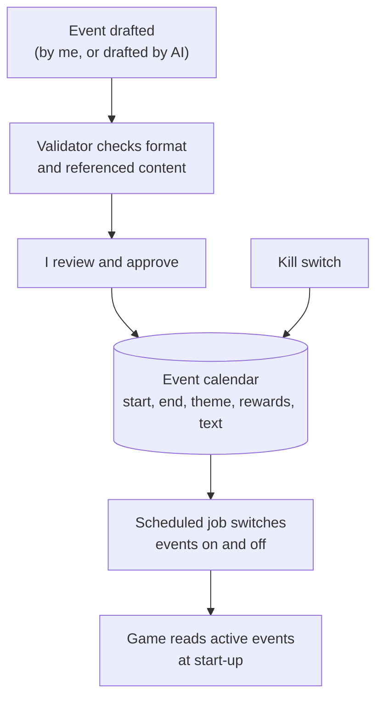

- Event fields: `id`, `title`, `startAt`, `endAt`, `theme`, `rules`, `rewards`, `bannerText`, `targets` (which build targets), `enabled`, `approved`.
- **AI may draft a calendar of events in advance** (for example freshers week, exam-week survival, harmattan week, Independence Day), but **nothing goes live without my approval.**
- A **kill switch** turns any event or feature off immediately, without redeploying.
- Events use only existing content and reward types. New reward types need a code change, not an event entry.
- Event times use one stated time zone, with local display. Test start, end, and clock changes.

## 23.2 Remote config and feature flags
- Flags and values (event on or off, reward slots on or off, demo gate size, announcement banner, maintenance mode) are read from the data layer, with safe defaults when offline.
- Every flag has an owner description, a default, and a validator rule. Unknown flags are rejected.
- The game must run correctly with **all flags at defaults and no network.**

## 23.3 In-game live devlog
A **"What's coming"** screen, fed from the data layer (or a JSON file in early versions):
- Current progress (for example "Dam level: 60 percent")
- Recent updates with screenshots
- Upcoming features, with a **vote button** (one vote per account or device, rate-limited)
- A bug-report button (sends state dump and version, with consent) and a link to Discord
- All text comes from data. It works offline using the last cached copy.

## 23.4 Reward slots (built now, switched off)
- Define **reward slots** in config: for example an extra outfit slot, an early level unlock, or a second try on a mission. Each slot has `id`, `type`, `rewardId`, `enabled` (default false), and `conditions`.
- Conditions that need **no ads** are allowed now: daily login streak, event completion, joining Discord, inviting a friend.
- A future "watch a video" condition plugs into `RewardService`. It stays off until I decide.
- Rule: **never put something behind a reward that was free before.** Add new rewards instead.

---

# 24. WEBSITE, DEPLOYMENT, AND OFFLINE PACKS

## 24.1 Hosting
- **Cloudflare Pages** for the website and game files (free tier allows commercial use, and static bandwidth is not metered). Re-check current limits before launch, including the **per-file size limit** (large assets need R2 or another storage).
- **Cloudflare R2** (or similar) for large content packs if needed. Verify current free limits and egress rules before relying on it.
- GitHub Pages and Vercel's free plan restrict commercial use, so they are not the long-term choice.
- Deploy flow: code in GitHub, push triggers a Cloudflare build, with preview deployments for testing.

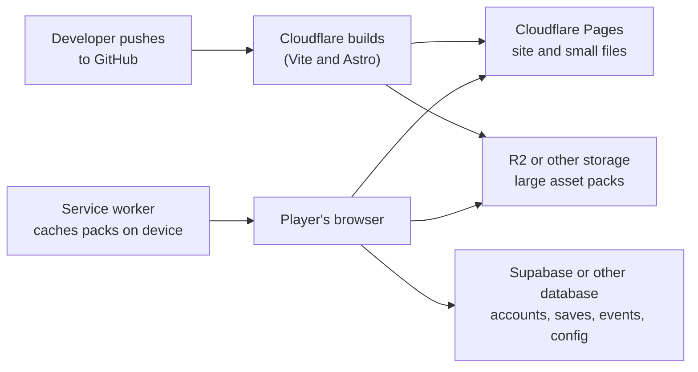

## 24.2 Website pages
- **Home:** hero with a Play button, short gameplay clip, feature cards, devlog preview, credits strip.
- **Play:** the game canvas, loading screen with pack progress, controls help, quality setting, and "download for offline."
- **Account and saves**, **Leaderboard**, **Devlog or News**, **Credits** (from the dynamic credits data), and a hidden login-protected **Admin** (Section 25).
- Public pages are **Astro** (little JavaScript). Interactive pages are **React islands**. The game code loads **only when the player presses Play.**
- Colours, name, and logo come from the dynamic config.

## 24.3 Content packs and streaming
Split the game into **4 to 6 packs** (for example core and opening area, campus centre, hostels, sculpture garden, dam, late game).

```mermaid
flowchart TD
    START["Player opens the game"] --> CORE["Download core pack<br/>engine, menus, opening area"]
    CORE --> PLAY["Play begins"]
    PLAY --> NEAR{"Player near the end<br/>of the current area?"}
    NEAR -->|yes| NEXT["Quietly download the next pack<br/>if allowed by connection settings"]
    NEXT --> CACHE[("Device cache<br/>service worker and storage")]
    CACHE --> OFFLINE["Later visits play mostly offline"]
    NEAR -->|no| PLAY
```

- A **pack manifest** lists each pack's version, size, checksum, and the areas it covers. The game downloads only what changed.
- Show each pack's size. Offer **Wi-Fi only**, **download everything**, and **download as I go.** Many players use mobile data.
- Ask the browser for **persistent storage**, handle quota errors, and **re-download any missing or evicted pack** automatically. iPhones and some browsers are stricter about storage, so test them.
- The game must never enter an area whose pack is missing. It shows a short loading or "downloading" state instead.
- Pack updates never break saves (versioned saves, Section 4.5).
- Size plan (also in Section 9.1): first load about 20 to 30 MB, total up to about 200 MB if justified by quality, no single file above the hosting limit.

## 24.4 Offline app (PWA)
- Manifest, service worker with versioned caches, offline play, and an update prompt.
- "Install" button on the website. Optional wrappers later (Capacitor for mobile, Tauri for desktop).
- The offline app still works without Supabase, using local data and the last cached config and events.

---

# 25. ADMIN DASHBOARD AND MULTI-GAME PLATFORM

## 25.1 Admin dashboard (React)
Rebuilds and extends the Django admin panels (Section 18) as a login-protected area:
- **Parity first:** every capability from the Django admin panels (fields, filters, search, inline editing, bulk actions, permissions).
- Then additions: **branding** (name, initials, tagline, colours, logo with live preview), **credits editor**, **event calendar editor with approval queue**, **remote config and flags**, **devlog editor**, **mission review queue** (later), **user and role management**, **audit log** (who changed what, old and new value), **config history with rollback**, and **dev tools** (validator results, cutscene previewer, bot reports).
- Roles: super admin, editor, moderator, player. Permissions are enforced by the **database access rules and server**, never by hiding buttons.
- Every admin change is logged and can be rolled back.

## 25.2 Many games, full control
- Each game is a folder with its own content, assets, config, and build targets. They share the engine packages, platform layer, data layer, and admin dashboard.
- A **games catalogue** in the database drives the website's games page. Each game has a status (hidden, demo, live), its own flags, and its own events.
- **Per-game and global kill switches.**
- Shared accounts and saves across games, with game-specific save data namespaced by game ID.
- Everything that varies per game is **data or config**, never copied code.

---

# 26. MARKETING TOOLS, COMMUNITY MISSIONS, AND MONETIZATION READINESS

## 26.1 Marketing capture tools (build into the game)
- **Photo mode:** free camera, hide HUD, time-of-day and weather controls, filters, and a share card with the logo generated from config.
- **Clip mode:** record short vertical and horizontal clips (use the cutscene camera system as a "trailer camera").
- **Clean capture:** a setting that hides debug overlays, admin tools, and any placeholder text.
- All captured images use the **current name and branding** from config.

## 26.2 Marketing plan (written for me, not part of the game code)
- Maintain `docs/MARKETING.md` with a content calendar, scripts, and reusable assets. AI can draft scripts, captions, thumbnails, and posters. Real footage comes from the game.
- Face-free formats: gameplay with on-screen captions, my voice or a text-to-speech voice, a recurring in-game character as narrator, and before-and-after bug-fix clips.
- A "building a game from zero" series with numbered days, weekly feature clips, funny campus moments, and viewer votes on names and features.
- Short clips are reused across TikTok, Instagram Reels, and YouTube Shorts with the community link (Discord) in the bio.
- Follow each platform's rules about labelling AI-generated content, and credit helpers.
- Never buy followers.

## 26.3 Community-built missions (data format now, creator tools later)
- Mission data (steps, locations, dialogue, rewards, cutscene hooks) already lives in data files. Design the mission schema so a **player-made mission is the same kind of file**, with **no code allowed in it**.
- Constrain by templates (deliver, find, race, collect), existing campus locations, approved reward lists, and text length limits. The validator checks every submission.
- Later phases: an in-game mission maker, a **moderation queue** (review, report button, word filters), sharing and ratings in the database, and creator credit.
- **Not in the first release.** Moderation takes time and many players are young. Do not build creator tools until the main game is stable. Record the schema decisions in `docs/DECISIONS.md`.

## 26.4 Monetization readiness (everything off for now)
- The game and website are **ad-free and free** for now, on every build target.
- Build the interfaces (`AdService`, `RewardService`, shop slots) with empty or disabled implementations so that later additions need no redesign.
- When the time comes (not now): cosmetics that do not affect fairness, optional rewarded video (always optional), supporter packs, sponsorship slots using the sign-slot system, and portal revenue share. Announce changes to the community first.
- **Payments from Nigeria:** research current payout options when needed (local processors for naira, and a route for foreign-currency payouts through a domiciliary account or payout service). Rules and fees change, so verify before choosing. Not part of the first build.
- Hosting must allow commercial use (Cloudflare Pages does at the time of writing, verify at launch).
- Privacy: publish a privacy policy, follow Nigeria's data protection law, ask consent for analytics and ad tracking, and be careful about players who are minors.
- No pay-to-win, no loot-box gambling mechanics, and clear prices.

---

# 27. KICKOFF MESSAGE

Copy this to the AI to start.

> Read `MASTER_GAME_GUIDE.md` (version 2) fully. Confirm in a few lines that you understand: the rules, the phases and approval gates, the single-source-of-truth requirement, dynamic config (no hard-coded name or initials), code-driven cutscenes, dynamic credits, the session protocol, the "complete files only" rule, and that the Django project must be **copied from, never changed or deleted**.
>
> Then start **Phase 0 only**:
> 1. Audit the whole game codebase and write `docs/AUDIT.md` covering every item in Section 2.1 and the questions in Sections 5.8 and 6.11.
> 2. Produce `docs/DJANGO_INVENTORY.md` (Section 18.2), including models, views, templates, static files, admin panels, settings, permissions, fixtures, packages, and row counts. Do not copy secrets or real personal data.
> 3. Capture the "before" screenshots described in Section 20.3 into `docs/graphics/before/`. If you cannot capture screenshots in your environment, say so and give me exact steps instead of inventing any.
> 4. Create `docs/STATE.md`, `CHANGELOG.md`, and `KNOWN_ISSUES.md` if they do not exist.
>
> Do not change any game code, and do not modify the Django project. When finished, give me: (1) the ranked list of conflicts between old and new level-1 code, (2) the answers to the audit questions, (3) the Django-to-new mapping table (Section 18.3), (4) your proposed Phase 1 extraction plan including how you will run SQLite locally and the run guide outline, (5) your proposed cleanup plan and smallest first slice, and (6) anything in this guide you think is unclear, wrong, or too heavy for the project. Wait for my approval before Phase 1.

---

# APPENDIX A. NAME IDEAS

These are suggestions only. The name is changed in config, never in code.

- **Sapa Life: Fresher Wahala**
- **Fresher Wahala**
- **Campus Gbedu**
- **Jand Life**
- **Omo School**
- **Aluta Life**
- **No Light, No Problem**
- **Hostel Lord**
- **Freshers School Life Game** (current working name)

# APPENDIX B. GLOSSARY

| Term | Meaning |
|---|---|
| **Single source of truth** | One place where a fact lives. Everything else reads it |
| **Token** | A placeholder such as `{{GAME_NAME}}` replaced at runtime from config |
| **Sign slot** | A data entry describing where a sign is, its size, and what it displays |
| **Quest Manager** | The only system that changes the current story step |
| **Director** | The system that plays a cutscene timeline |
| **End state** | The exact game state after a cutscene, applied instantly when skipped |
| **Ambient cutscene** | A cutscene that plays while the player keeps control |
| **Role (casting)** | A cutscene placeholder such as `FRIEND_1` filled by whoever is present |
| **Validator** | A check that scans game data and fails loudly on inconsistency |
| **Debug API** | Dev-only functions that let bots control and inspect the game |
| **Monkey bot** | A bot that plays randomly to find crashes and soft-locks |
| **LOD** | Level of detail: simpler models and animation at a distance |
| **Pool** | Reused objects to avoid memory allocation during play |
| **PWA** | Progressive web app: installable and works offline |
| **Vertical slice** | One small part of the game finished to final quality |
| **Build target** | A version of the game built for one place (website, portal demo, offline app) |
| **Adapter** | A small piece of code that gives the game a target-specific behaviour |
| **Content pack** | A downloadable chunk of game assets for one area |
| **Repository (data layer)** | A typed interface through which all data is read and written |
| **Kill switch** | A flag that switches a feature or event off without redeploying |
| **Reward slot** | A configurable place where a reward can be earned, off by default |
| **Parity** | The new project matching the old Django version's behaviour |
| **PBR** | Physically based rendering: realistic materials and lighting |
| **KTX2** | A compressed texture format that saves memory on phones |
| **GLB** | A single-file 3D model format |
| **R2** | Cloudflare's file storage service |

# APPENDIX C. ASSET AND VOICE SOURCES (LICENCES MUST BE CHECKED)

Always check the licence of each file at the time of use, record it in `assets/ASSET_LICENSES.md`, and prefer licences that allow commercial use.

| Need | Places to look |
|---|---|
| Textures, sky lighting (HDRI), some models | Poly Haven |
| Models and asset packs | Kenney, Quaternius, Sketchfab (licences vary per model) |
| Character animations | Mixamo (free with an account, check current terms) |
| Sounds | Freesound, OpenGameArt (licences vary per file) |
| Music | Check licences carefully, or commission original tracks |
| Voices (placeholders or background) | Local open-source text-to-speech run by a batch script (for example Kokoro or Piper), checking each model and voice licence |
| Voices (real) | Recordings from friends or volunteers, with written permission and a credit entry |

**Voice pipeline:** a script reads the dialogue data, generates one audio file per line with a chosen voice, writes OGG (or MP3) files with predictable names, and logs the model and licence used. Generated voices are placeholders until replaced. Free online tools may restrict commercial use, so check before shipping.

# APPENDIX D. BEGINNER RUN GUIDE REQUIREMENTS

`docs/RUN_GUIDE.md` must let someone who has never seen the project run it. It must include:
1. What to install (Node.js LTS, Git, a code editor) with download names and version numbers.
2. How to get the project onto a computer.
3. The exact commands for: install, start development (website, game, and dev API with seeded SQLite), reset and reseed the dev database, run the validator, run the tests, run the bots, build for production, and preview the build.
4. Where the SQLite file lives and how to look at it.
5. How to open the admin dashboard locally and the dev login.
6. How to change the game name and see it update everywhere.
7. How to switch build targets (website, portal demo, offline app).
8. Common errors and their fixes.
9. How to export a backup of the database and restore it.
10. A "what I should see" description or screenshot after each major step.
Every command must have been tested, or must be marked clearly as untested.
